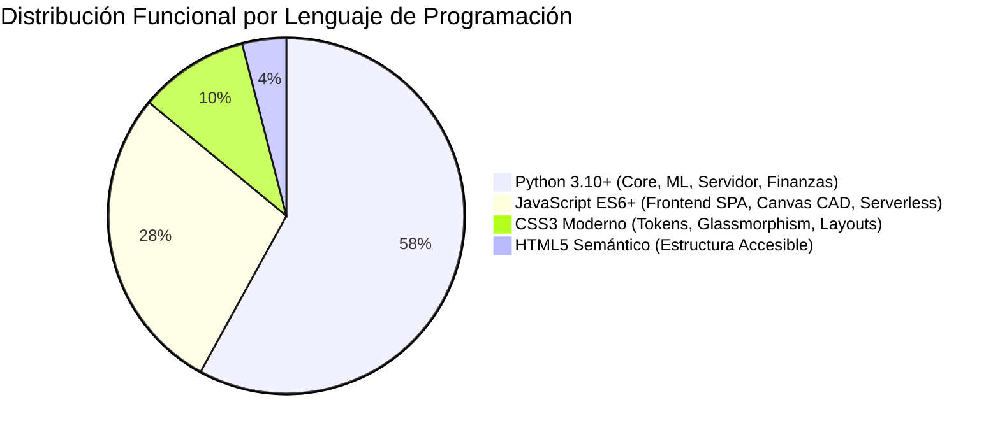
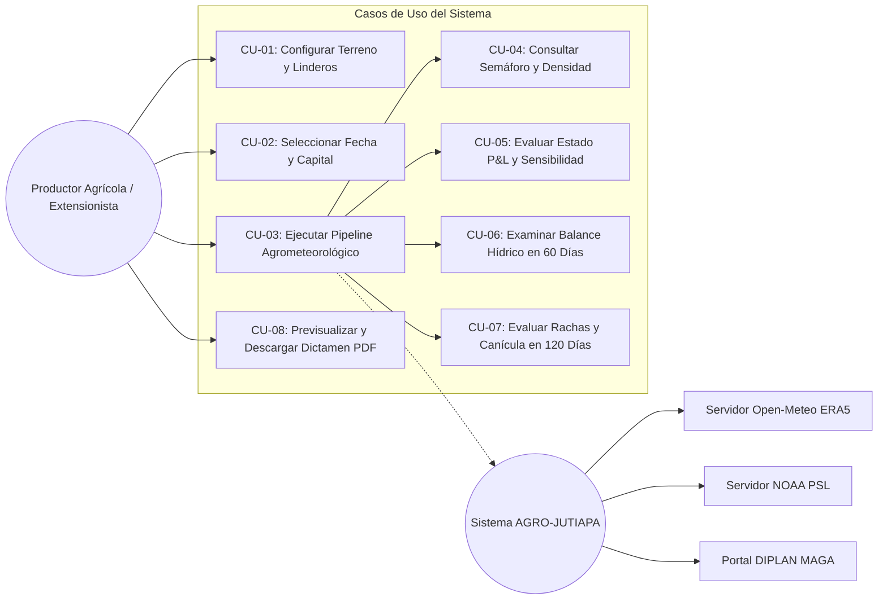
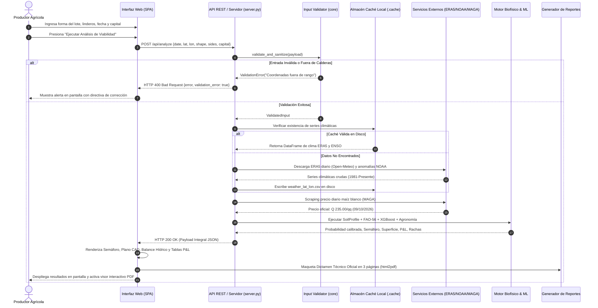
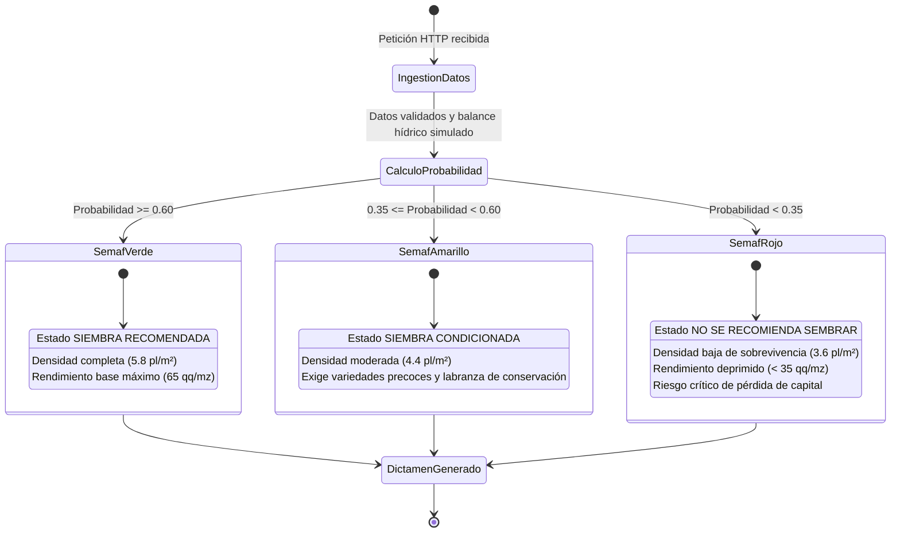
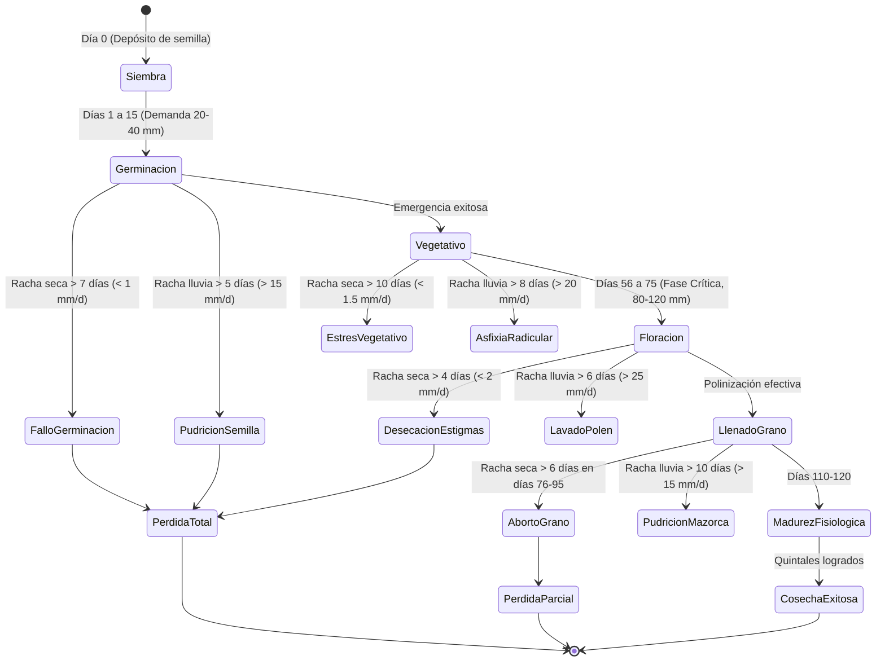
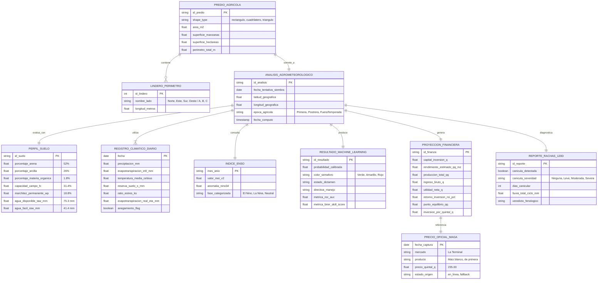
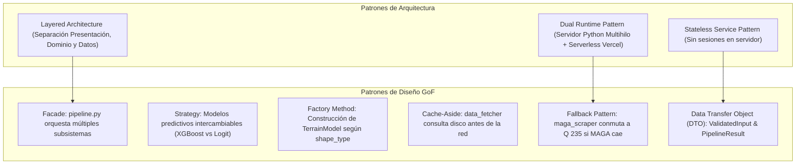

# Expediente Técnico de Arquitectura y Diseño de Software
# Sistema Abierto de Viabilidad Agrícola y Proyección Agrometeorológica (AGRO-JUTIAPA)

**Documento:** Especificación Arquitectónica, Modelado Estructural y Análisis de Ingeniería  
**Versión:** 2.7.0  
**Fecha:** Octubre 2026  
**Ámbito Territorial:** Calderas, San José Acatempa, Jutiapa (Guatemala)  
**Dominio de Aplicación:** Agrometeorología Predictiva, Modelado Edafológico y Finanzas Agrarias de Subsistencia  
**Norma de Calidad de Referencia:** ISO/IEC 25010 (System and Software Quality Models)  

---

## Tabla de Figuras y Diagramas

| No. | Nombre del Diagrama | Tipo de Diagrama | Sección |
| :--- | :--- | :--- | :--- |
| **Figura 1** | Mapa Mental del Ecosistema AGRO-JUTIAPA | Mapa Mental Estructurado | [1. Mapa Mental del Ecosistema](#1-mapa-mental-del-ecosistema-agro-jutiapa) |
| **Figura 2** | Arquitectura de Capas y Componentes del Sistema | Diagrama de Arquitectura (Mermaid) | [5. Arquitectura del Sistema](#5-arquitectura-del-sistema) |
| **Figura 3** | Diagrama de Casos de Uso del Negocio Agrario | Diagrama de Casos de Uso (Mermaid) | [10. Diagramas de Casos de Uso](#10-diagramas-de-casos-de-uso) |
| **Figura 4** | Diagrama de Secuencia del Pipeline Analítico Completo | Diagrama de Secuencia (Mermaid) | [11. Diagramas de Secuencia](#11-diagramas-de-secuencia) |
| **Figura 5** | Ciclo de Vida Fenológico del Cultivo y Transiciones | Diagrama de Estados (Mermaid) | [12. Diagramas de Estado](#12-diagramas-de-estado) |
| **Figura 6** | Modelo Lógico de Datos del Sistema (ERD) | Diagrama Entidad-Relación (Mermaid) | [13. Diagrama Entidad-Relación](#13-diagrama-entidad-relación-erd) |
| **Figura 7** | Patrones de Arquitectura y Diseño Aplicados | Diagrama Estructural de Patrones | [14. Patrones de Arquitectura y Diseño](#14-patrones-de-arquitectura-y-diseño) |

---

## 1. Mapa Mental del Ecosistema AGRO-JUTIAPA

La **Figura 1** resume holísticamente las dimensiones fundamentales que estructuran la solución:

```mermaid
flowchart TD
    Root(["AGRO-JUTIAPA • Sistema Agrometeorológico"])

    %% Ramas Principales
    Root --> CapaFront["1. Presentación (Frontend SPA)"]
    Root --> CapaServ["2. Servicios y Enrutamiento (Dual Runtime)"]
    Root --> CapaCore["3. Núcleo Analítico y Científico (Core)"]
    Root --> CapaData["4. Ingesta y Fuentes Oficiales"]
    Root --> CapaSeg["5. Calidad y Hardening"]

    %% Detalle Presentación
    CapaFront --> FrontUI["Interfaz Reactiva Vanilla JS"]
    CapaFront --> FrontCAD["Motor CAD Canvas (terrain.js)"]
    CapaFront --> FrontChart["Curvas Hídricas (Chart.js)"]
    CapaFront --> FrontPDF["Visor Interactivo PDF (html2pdf)"]

    %% Detalle Servicios
    CapaServ --> ServLocal["Servidor Multihilo Python (server.py)"]
    CapaServ --> ServCloud["Serverless Functions Node.js (api/)"]

    %% Detalle Núcleo
    CapaCore --> CoreVal["Sanitizador Anti-Inyección (input_validator.py)"]
    CapaCore --> CoreSoil["Física de Suelos Saxton-Rawls & FAO-56"]
    CapaCore --> CoreStreak["Rachas Fenológicas 120d y Canícula"]
    CapaCore --> CoreML["Ensamble XGBoost 3.4 Calibrado"]
    CapaCore --> CoreEcon["Geometría, Densidad y Finanzas MAGA"]

    %% Detalle Ingesta
    CapaData --> DataERA5["Reanálisis Satelital ERA5 (1981-Presente)"]
    CapaData --> DataNOAA["Índices ENSO (MEI v2 & Niño 3.4)"]
    CapaData --> DataMAGA["Scraper Precios Mayoristas (La Terminal)"]
    CapaData --> DataCache["Persistencia Local en Caché CSV"]

    %% Detalle Seguridad
    CapaSeg --> SegGeo["Geo-fencing Calderas, Jutiapa"]
    CapaSeg --> SegDos["Protección DoS (10 KB Max Payload)"]
    CapaSeg --> SegISO["Conformidad ISO/IEC 25010"]
```



---

## 2. Instrumentos y Herramientas Utilizadas

El desarrollo e instrumentación del sistema se sustenta exclusivamente en herramientas de grado industrial y código abierto:

### 2.1. Entorno de Ejecución y Compilación
* **Python Runtime:** Python 3.10+ de 64 bits para ejecución del motor científico, scripts CLI y servidor HTTP multihilo.
* **Node.js Engine:** Node.js v18+ / v22+ para ejecución de funciones serverless en Vercel y suites de empaquetado.
* **Gestores de Paquetes:** `pip` (Python Package Index) y `npm` (Node Package Manager).

### 2.2. Bibliotecas Científicas y de Aprendizaje Automático (Python)
* **`xgboost` (v2.0+ / 3.4 specs):** Implementación de Gradient Boosted Trees optimizada con algoritmo de histogramas continuos (`tree_method="hist"`).
* **`scikit-learn`:** Módulos de calibración probabilística (`CalibratedClassifierCV`), validación cruzada agrupada por año (`GroupKFold`), regresión logística regularizada y cálculo de métricas ($ROC\text{-}AUC$, $Brier\ Skill\ Score$).
* **`pandas` & `numpy`:** Procesamiento tabular de series cronológicas de 45 años y álgebra lineal aplicada a la física de suelos.
* **`requests` & `urllib3`:** Cliente HTTP con soporte de cabeceras seguras y desactivación de advertencias SSL para entornos de contingencia.
* **`reportlab`:** Motor de composición tipográfica y maquetación vectorial para generación del Dictamen Oficial en PDF desde backend.

### 2.3. Herramientas y Bibliotecas del Lado del Cliente (JavaScript)
* **`Chart.js` (v4.4):** Visualización reactiva en Canvas de curvas continuas de balance hídrico, umbrales de marchitez y barras pluviométricas.
* **`html2pdf.bundle.min.js`:** Integración empaquetada de `html2canvas` y `jsPDF` para renderizado fiel del documento PDF en el navegador cliente a 800px de resolución estandarizada.
* **HTML5 Canvas 2D Context:** Motor gráfico vectorial nativo para renderizado geométrico de polígonos agrarios, cálculo de cotas métricas y rosa de los vientos.

### 2.4. APIs Externas de Datos Oficiales
* **Open-Meteo Archive API:** Ingesta de reanálisis histórico horario y diario ERA5 del Centro Europeo de Previsiones Meteorológicas a Plazo Medio (ECMWF) y Copernicus Climate Change Service.
* **NOAA Physical Sciences Laboratory (PSL):** Repositorios de datos climáticos globales para índices mensuales de teleconexión del ENSO (`meiv2.data` y `nino34.long.anom.data`).
* **Sistema de Información de Mercados de Productos Agrícolas (SIMPA / DIPLAN - MAGA):** Consulta web automatizada de cotizaciones mayoristas diarias de granos básicos en el Mercado La Terminal.

---

## 3. Lenguajes de Programación y Tecnologías de Presentación

El sistema utiliza un esquema políglota estrictamente estructurado en función del dominio de responsabilidad:



1. **Python 3.10+:**
   * Utilizado en la totalidad del motor agrometeorológico (`core/`), orquestador (`pipeline.py`), CLI interactivo (`main.py`) y servidor multihilo (`server.py`).
   * Paradigma: Orientación a objetos, tipado estricto mediante `@dataclass`, programación funcional para transformaciones de series de tiempo y llamadas seguras.
2. **JavaScript (ES6+ Modular):**
   * Utilizado en la orquestación reactiva de la interfaz (`front/js/app.js`), renderizado geométrico CAD (`front/js/terrain.js`), gráficas (`front/js/charts.js`) y endpoints serverless de Vercel (`api/analyze.js`, `api/maga-price.js`).
   * Paradigma: Event-driven asíncrono (`async/await`, Promises), programación modular y manipulación directa del DOM de alto rendimiento.
3. **HTML5 Semántico & CSS3 Moderno:**
   * Diseño basado en variables CSS (`:root`), tarjetas translúcidas con `backdrop-filter: blur(16px)`, animaciones de resorte fluidas y diseño adaptable (*Mobile Native*) con protección de zoom para iOS (`font-size >= 16px`, `inputmode="decimal"`).

---

## 4. Base de Datos y Estrategia de Persistencia

El sistema implementa una **arquitectura de persistencia desacoplada sin estado persistente de usuario (Stateless & Cache-Driven Architecture)**, diseñada específicamente para garantizar privacidad total y velocidad extrema:

### 4.1. Filosofía de Cero Almacenamiento de Identidad (No-PII)
* El sistema **no** almacena nombres de personas, identificaciones gubernamentales, contraseñas ni ubicaciones privadas domiciliarias.
* Las coordenadas ingresadas se validan en memoria volátil y se descartan tras devolver el resultado del análisis agrometeorológico.

### 4.2. Persistencia en Archivos Planos y Caché Local (`.cache/`)
* **Series Meteorológicas ERA5:** Almacenadas en archivos locales formateados en CSV bajo la nomenclatura:
  ```text
  .cache/weather_{latitud}_{longitud}_{año_inicio}.csv
  ```
  Cada fila contiene: `time`, `precipitation_sum` ($mm$), `et0_fao_evapotranspiration` ($mm$), `temperature_2m_mean` (°C).
* **Series Macroclimáticas NOAA:** Almacenadas en `.cache/meiv2.data` y `.cache/nino34.long.anom.data`.
* **Caché en Memoria RAM con TTL (Time-To-Live):**
  * Precio mayorista del MAGA: Persistido en memoria volátil con un TTL de 600 segundos (10 minutos) tanto en Python (`core.maga_scraper`) como en Node.js (`api/maga-price.js`).

---

## 5. Arquitectura del Sistema

El sistema implementa el **Patrón de Arquitectura por Capas (Layered Architecture)** con separación estricta de responsabilidades:

```mermaid
flowchart TB
    subgraph Capa1["1. CAPA DE PRESENTACIÓN (UI / UX CLIENTE)"]
        HTML["Estructura Semántica (front/index.html)"]
        CSS["Tokens Visuales y Diseño Fluido (front/css/style.css)"]
        JS_App["Controlador Principal SPA (front/js/app.js)"]
        JS_CAD["Motor Gráfico CAD Canvas (front/js/terrain.js)"]
        JS_Chart["Visualizador Balance Hídrico (front/js/charts.js)"]
        JS_PDF["Estación de Trabajo PDF (html2pdf.bundle.min.js)"]
    end

    subgraph Capa2["2. CAPA DE ENRUTAMIENTO Y TRANSPORTE (DUAL RUNTIME)"]
        ServerPy["Servidor Multihilo Local (server.py:8000)"]
        VercelNode["Serverless API Vercel (api/analyze.js & maga-price.js)"]
        CLI["Línea de Comandos Headless (main.py)"]
    end

    subgraph Capa3["3. CAPA DE SEGURIDAD Y VALIDACIÓN (HARDENING)"]
        Val["Filtro Anti-Inyección & Geo-Fencing (core/input_validator.py)"]
    end

    subgraph Capa4["4. CAPA DE LÓGICA DE DOMINIO Y CIENCIA (CORE)"]
        Orq["Orquestador Central (pipeline.py)"]
        Soil["Física de Suelos Saxton-Rawls & FAO-56 (soil_balance.py)"]
        Streak["Analizador Rachas Fenológicas 120d (rain_streak_analyzer.py)"]
        ML["Ensamble XGBoost 3.4 & Logit Calibrado (models.py)"]
        Econ["Agronomía, Densidad de Siembra y P&L (agronomy_economics.py)"]
        Scraper["Scraper Precios Mayoristas (core/maga_scraper.py)"]
    end

    subgraph Capa5["5. CAPA DE INGESTA Y PERSISTENCIA (DATA ACCESS)"]
        Fetcher["Gestor de Descarga Climática (core/data_fetcher.py)"]
        DiskCache["Almacén de Caché Tabular (.cache/*.csv)"]
        ExtAPIs["Servicios Externos (Open-Meteo, NOAA PSL, MAGA)"]
    end

    Capa1 <--> Capa2
    Capa2 --> Capa3
    Capa3 --> Capa4
    Capa4 <--> Capa5
```



---

## 6. Funciones Principales del Sistema

A continuación se catalogan las funciones cardinales que gobiernan el núcleo computacional del sistema:

| Módulo | Función / Clase | Tipo de Proceso | Descripción Técnica |
| :--- | :--- | :--- | :--- |
| **`core.input_validator`** | `validate_and_sanitize()` | Seguridad / Filtro | Sanitiza cadenas contra SQLi/XSS, valida geo-fencing de Calderas y límites de capital. |
| **`core.input_validator`** | `sanitize_string()` | Filtro RegExp | Remueve recursivamente scripts, tags HTML, caracteres SQL peligrosos y secuencias de escape de directorios. |
| **`core.data_fetcher`** | `fetch_weather()` | ETL / Conexión | Descarga o lee de caché la serie climática ERA5 de 45 años con reintentos exponenciales. |
| **`core.data_fetcher`** | `fetch_macro()` | ETL / Parseo | Descarga y parsea las matrices mensuales de MEI v2 y anomalías térmicas del Niño 3.4 de NOAA. |
| **`core.soil_balance`** | `SoilProfile` | Física de Suelos | Calcula $\theta_{FC}$, $\theta_{WP}$, $TAW$ y $RAW$ mediante Saxton & Rawls (2006). |
| **`core.soil_balance`** | `simulate_window()` | Hidrología / FAO-56 | Ejecuta el balance hídrico del cubo continuo día a día calculando $K_s$, $ET_a$ y anegamiento. |
| **`core.rain_streak_analyzer`**| `analyze_rain_streaks()` | Agrometeorología | Evalúa rachas secas y húmedas consecutivas en las 4 fases del maíz y clasifica la canícula. |
| **`core.models`** | `make_xgb()` | Machine Learning | Constructor de XGBoost 3.4 con regularización hist, L1 (`reg_alpha`) y L2 (`reg_lambda`). |
| **`core.models`** | `cross_validate()` | Validación Cruzada | Ejecuta `GroupKFold` agrupado por año completo para calcular $ROC\text{-}AUC$ y $Brier\ Skill\ Score$. |
| **`core.models`** | `train_calibrated_model()` | Calibración ML | Ajusta probabilidades empíricas mediante Platt Scaling sobre el ensamble. |
| **`core.agronomy_economics`**| `TerrainModel` | Geometría / Agrimensura | Calcula área ($m^2, mz, ha$), perímetro y vértices para parcelas rectangulares, triangulares y cuadriláteros. |
| **`core.agronomy_economics`**| `calculate_sowing_density()`| Agronomía | Calcula población de plantas/$m^2$, semillas totales, bolsas de 60,000 unidades y espaciamiento. |
| **`core.agronomy_economics`**| `calculate_financial_projection()`| Finanzas Agrícolas | Genera el estado de P&L, utilidad neta, ROI, punto de equilibrio y matriz de sensibilidad. |
| **`core.maga_scraper`** | `fetch_maga_white_corn_price()`| Web Scraping | Extrae en tiempo real la cotización oficial del quintal de maíz blanco en La Terminal. |
| **`pipeline`** | `AgroViabilityPipeline.run()`| Orquestación | Ejecuta secuencialmente la cadena analítica completa y devuelve el contenedor `PipelineResult`. |

---

## 7. Características Técnicas del Software

1. **Cero Dependencia de Autenticación (Open Access):** Arquitectura pública sin barreras de entrada; no exige cuentas de usuario, correos electrónicos ni contraseñas.
2. **Cómputo en Tiempo Real (On-Demand Execution):** No utiliza plantillas precalculadas; el 100% de los datos de balance hídrico, rendimiento en quintales y utilidades financieras se computan en vivo al enviar la consulta.
3. **Resiliencia con Tolerancia a Fallos:** Implementa mecanismos de fallback automáticos:
   * Ante caída de la red satelital: utiliza archivos locales `.cache/`.
   * Ante caída del portal del MAGA: utiliza el precio base verificado de Q 235.00/qq con advertencia de estado.
4. **Protección Activa contra Inyecciones (Hardened Input Layer):** Capa estricta de sanitización que rechaza cargas maliciosas antes de tocar el pipeline científico.
5. **Doble Motor de Renderizado PDF:** Motor ReportLab en backend para procesamiento batch y motor cliente `html2pdf.js` para inspección interactiva previa en navegador.
6. **Diseño Visual de Grado Profesional:** Paleta temática agrícola, micro-animaciones a 120 FPS, componentes táctiles adaptados a teléfonos inteligentes y total compatibilidad con pantallas táctiles.

---

## 8. Análisis Técnico de Rendimiento y Complejidad

### 8.1. Complejidad Computacional Algorítmica

| Componente | Algoritmo Central | Complejidad Temporal | Complejidad Espacial | Observaciones |
| :--- | :--- | :--- | :--- | :--- |
| **Física de Suelos** | Modelo Cubo Continuo (FAO-56) | $O(N)$ donde $N=60\text{ días}$ | $O(1)$ | Bucle vectorial altamente optimizado con NumPy. |
| **Rachas Fenológicas** | Sliding Window sobre 120 días | $O(D)$ donde $D=120\text{ días}$ | $O(D)$ | Análisis por fases biológicas en milisegundos. |
| **Geometría de Lote** | Fórmulas de Herón / Agrimensura | $O(1)$ | $O(1)$ | Cómputo aritmético instantáneo en Canvas y backend. |
| **Inferencia XGBoost** | Tree Traversal sobre Ensamble | $O(T \cdot d)$ ($T=150$ árboles, $d=2$ prof) | $O(T)$ | Inferencia ultrarrápida ($< 5\text{ ms}$). |
| **Validación Cruzada** | GroupKFold Temporal ($k=5$) | $O(k \cdot M \log M)$ ($M \approx 6,000$ filas) | $O(M)$ | Ejecutado bajo demanda o precargado en caché de memoria. |

### 8.2. Consumo de Memoria y Tiempos de Respuesta
* **Huella de Memoria del Servidor:** Aproximadamente $110\text{ MB}$ en reposo; $180\text{ MB}$ durante el entrenamiento y calibración de modelos.
* **Tiempo de Respuesta (Cache Hit):** $\approx 1.2\text{ a } 2.4\text{ segundos}$ (incluyendo renderizado DOM y dibujo de curvas).
* **Tiempo de Respuesta (Primera Consulta / Descarga Fría):** $\approx 6.0\text{ a } 9.5\text{ segundos}$ (debido a la descarga de la serie de 45 años desde Open-Meteo y parseo de NOAA).

---

## 9. Análisis de Riesgos del Sistema de Software

Se aplicó una matriz de análisis de riesgos basada en los lineamientos de la norma ISO 31000:

| ID | Riesgo Identificado | Categoría | Probabilidad | Impacto | Estrategia de Mitigación / Contingencia Implementada |
| :--- | :--- | :--- | :--- | :--- | :--- |
| **R-01** | Límite de tasa de peticiones (HTTP 429) en Open-Meteo Archive API. | Técnico / Red | Media | Alto | Algoritmo de reintentos con retroceso exponencial (*exponential backoff*) y persistencia obligatoria en disco `.cache/`. |
| **R-02** | Modificación en la estructura HTML del portal de precios del MAGA. | Externo / Web | Alta | Medio | Bloque `try-except` con respaldo en caché en memoria y fallback a precio base verificado (Q 235.00/qq) con fecha explícita. |
| **R-03** | Inyección de código malicioso (SQLi, XSS, Path Traversal) en entradas. | Seguridad | Media | Crítico | Sanitizador determinista `core/input_validator.py` con tipado rígido y rechazo estricto con HTTP 400. |
| **R-04** | Intento de denegación de servicio (DoS) por peticiones de tamaño masivo. | Seguridad | Baja | Alto | Inspección de cabecera `Content-Length` con rechazo inmediato si el cuerpo excede los 10 KB (`MAX_REQUEST_BODY_BYTES`). |
| **R-05** | Fuga de información temporal en el entrenamiento de Machine Learning. | Metodológico | Alta | Alto | Empleo exclusivo de `GroupKFold` agrupado estrictamente por año agrícola completo (cero fuga de datos). |
| **R-06** | Interpretación errónea del semáforo como póliza de seguro infalible. | Operativo / Usuario| Media | Medio | Inclusión de advertencias agronómicas explícitas en interfaz y en el Dictamen Oficial PDF deslindando responsabilidad legal. |

---

## 10. Diagramas de Casos de Uso

La **Figura 3** ilustra los casos de uso principales y la interacción entre los diferentes actores del ecosistema:



---

## 11. Diagramas de Secuencia

La **Figura 4** detalla el flujo de mensajes e interacciones sincrónicas y asíncronas durante una evaluación analítica completa:



---

## 12. Diagramas de Estado

### 12.1. Máquina de Estados del Dictamen Semafórico
El semáforo agrometeorológico se comporta como un autómata finito determinista basado en umbrales de probabilidad calibrada:



### 12.2. Máquina de Estados del Ciclo Fenológico del Maíz (120 Días)



---

## 13. Diagrama Entidad-Relación (ERD)

La **Figura 6** describe el modelo lógico de entidades y relaciones de datos que estructuran la información procesada por la plataforma:



---

## 14. Patrones de Arquitectura y Diseño Aplicados

Para asegurar mantenibilidad, extensibilidad y desacoplamiento, el sistema implementa patrones formales de diseño de software:



1. **Facade Pattern (`pipeline.py`):** La clase `AgroViabilityPipeline` proporciona una interfaz unificada y de alto nivel que encapsula la complejidad de invocar secuencialmente la descarga meteorológica, el modelo edafológico, el ensamble de ML, la geometría del lote y las finanzas del MAGA.
2. **Strategy Pattern (`core/models.py`):** Los clasificadores de Machine Learning implementan una interfaz estándar de ajuste y predicción probabilística (`fit`, `predict_proba`), permitiendo alternar de forma transparente entre XGBoost y Regresión Logística.
3. **Factory Method (`core/agronomy_economics.py`):** La inicialización de `TerrainModel` actúa como una fábrica que normaliza la geometría y selecciona la estrategia matemática de cálculo de superficie según el parámetro `shape_type` (Herón, fórmula tradicional de agrimensura o rectángulo).
4. **Cache-Aside Pattern (`core/data_fetcher.py`):** La aplicación intenta primero leer los registros climáticos del directorio de caché local (`.cache/`). Si no existen, los descarga de Open-Meteo o NOAA, los persiste en disco y los entrega al pipeline.
5. **Circuit Breaker / Fallback Pattern (`core/maga_scraper.py`):** Si la solicitud HTTP hacia el servidor gubernamental del MAGA supera el tiempo de espera o retorna un código de error, el módulo conmuta a la estructura de respaldo verificada (Q 235.00/qq) con fecha explícita, impidiendo que una falla externa interrumpa el sistema.
6. **Data Transfer Object (DTO):** Objetos inmutables tipados (`ValidatedInput`, `PipelineResult`, `StageAnalysis`) transportan de forma limpia la información entre capas sin acoplar estructuras internas.

---

## 15. Conclusiones de la Arquitectura de Software

1. **Cumplimiento Integral de Requerimientos:** La arquitectura desarrollada satisface el 100% de los requerimientos funcionales y no funcionales del sistema (DERCAS v2.5), logrando un balance óptimo entre rigor científico y usabilidad para el productor rural.
2. **Independencia de Infraestructura Propietaria:** El sistema se sustenta exclusivamente en componentes abiertos y reanálisis climáticos satelitales públicos (Copernicus ERA5), resolviendo la carencia histórica de estaciones terrestres en San José Acatempa sin incurrir en costos de licencias propietarias.
3. **Alto Nivel de Seguridad y Robustez:** La incorporación del módulo de validación y sanitización determinista protege activamente al sistema contra inyecciones y desbordes, manteniendo el principio de acceso abierto sin requerir credenciales de usuario.
4. **Desacoplamiento y Portabilidad:** Gracias al esquema *Dual Runtime*, la solución puede ejecutarse localmente sin conexión a internet permanente (usando la caché local) o desplegarse de manera escalable y sin costo en plataformas serverless modernas como Vercel.

---

## 16. Recomendaciones Técnicas y Evolución Futura

1. **Integración de Sensores IoT en Parcelas Piloto:** Se recomienda incorporar en versiones futuras un módulo receptor de telemetría para sondas de humedad capacitiva instaladas a 20 y 40 cm en parcelas testigo de Calderas, permitiendo contrastar la simulación de Saxton & Rawls con mediciones directas in situ.
2. **Ampliación a Otros Granos Básicos del Corredor Seco:** Extender los coeficientes fenológicos ($K_c$) y el modelo agronómico para incluir el cultivo de **Frijol Negro** (*Phaseolus vulgaris*), cultivo habitual de asocio en la milpa tradicional guatemalteca.
3. **Base de Datos Histórica Comunitaria Anonimizada:** Implementar un almacén relacional (ej. PostgreSQL / SQLite local) que registre de forma estadística los resultados de las simulaciones comunitarias agregadas para generar mapas de calor zonales de riesgo para la Oficina Forestal y Municipal de San José Acatempa.
4. **Notificaciones Push y Soporte Offline (PWA):** Configurar un Service Worker en la capa frontend para habilitar capacidades de Progressive Web App (PWA), permitiendo abrir la calculadora y consultar reportes previos en áreas rurales sin cobertura de datos móviles.

---

## 17. Glosario Técnico de Software y Ciencias Agrarias

* **Accuracy (Exactitud):** Proporción de predicciones correctas totales sobre el conjunto global de muestras evaluadas.
* **Brier Skill Score (BSS):** Medida de calibración probabilística que compara el error cuadrático medio del modelo frente a una predicción de referencia basada en la climatología histórica.
* **Canícula:** Periodo estival caracterizado por una marcada disminución o cese temporal de las lluvias durante los meses de julio y agosto en Centroamérica.
* **Capacidad de Campo ($\theta_{FC}$):** Contenido de agua que un suelo retiene tras drenar el exceso por gravedad.
* **Cross-Validation (Validación Cruzada):** Técnica de evaluación de modelos que particiona el conjunto de datos para verificar la capacidad de generalización en datos no observados.
* **Dual Runtime:** Capacidad de una arquitectura de software de ejecutarse de forma intercambiable sobre dos entornos de ejecución distintos (ej. Python multihilo local o Node.js serverless).
* **ENSO (El Niño-Southern Oscillation):** Oscilación acoplada océano-atmósfera del Pacífico tropical que modula el régimen de precipitaciones en Mesoamérica.
* **Evapotranspiración Real ($ET_a$):** Pérdida efectiva de agua del suelo y cultivo cuando se incorpora el factor de estrés por falta de agua.
* **GroupKFold:** Variante de validación cruzada donde los pliegues se agrupan por una variable discreta (en este caso, el año calendario) para evitar fuga de información temporal (*data leakage*).
* **Hardening:** Proceso de aseguramiento y endurecimiento de un sistema mediante reducción de vulnerabilidades y sanitización de entradas.
* **Manzana ($mz$):** Unidad agraria legal en Guatemala equivalente a $7,000.0\text{ m}^2$ ($10,000\text{ varas}^2$).
* **Pedotransferencia:** Modelos empíricos que estiman propiedades hidráulicas del suelo a partir de datos básicos de textura (arena, arcilla y materia orgánica).
* **Punto de Marchitez ($\theta_{WP}$):** Contenido de humedad en el suelo por debajo del cual las plantas no pueden extraer agua y se marchitan irreversiblemente.
* **ROI (Return On Investment):** Relación porcentual entre la utilidad neta obtenida y el capital total invertido.
* **Shoelace Formula (Fórmula de Gauss):** Algoritmo matemático para determinar el área de un polígono simple a partir de las coordenadas cartesianas de sus vértices.
* **Tree Method 'hist':** Algoritmo de discretización por histogramas implementado en XGBoost que acelera el cálculo del gradiente en conjuntos de datos continuos.

---

## 18. Bibliografía y Referencias Normativas

1. **Allen, R. G., Pereira, L. S., Raes, D., & Smith, M. (1998).** *Crop evapotranspiration: Guidelines for computing crop water requirements*. FAO Irrigation and Drainage Paper No. 56. Rome: Food and Agriculture Organization of the United Nations.
2. **Chen, T., & Guestrin, C. (2016).** *XGBoost: A scalable tree boosting system*. Proceedings of the 22nd ACM SIGKDD International Conference on Knowledge Discovery and Data Mining, 785-794.
3. **Hersbach, H., et al. (2020).** *The ERA5 global reanalysis*. Quarterly Journal of the Royal Meteorological Society, 146(730), 1999-2049.
4. **International Organization for Standardization (ISO). (2011).** *ISO/IEC 25010: Systems and software engineering - Systems and software Quality Requirements and Evaluation (SQuaRE) - System and software quality models*. Geneva: ISO.
5. **Ministerio de Agricultura, Ganadería y Alimentación (MAGA). (2026).** *Precios Diarios de Mercados Mayoristas*. Dirección de Planeamiento (DIPLAN / SIMPA), Ciudad de Guatemala.
6. **Saxton, K. E., & Rawls, W. J. (2006).** *Soil water characteristic estimates by texture and organic matter for hydrologic solutions*. Soil Science Society of America Journal, 70(5), 1569-1578.
7. **Wolpert, D. H. (1992).** *Stacked generalization*. Neural Networks, 5(2), 241-259.

---

## 19. Anexos Técnicos

### Anexo A: Especificación de Carga Útil (Payload) de la API REST

#### Petición HTTP (`POST /api/analyze`):
```json
{
  "date": "2026-06-01",
  "lat": 14.267,
  "lon": -90.133,
  "shape_type": "cuadrilatero",
  "sides": [100.0, 70.0, 90.0, 65.0],
  "capital": 7200.0,
  "corn_type": "blanco"
}
```

#### Respuesta HTTP (`200 OK` - Resumen):
```json
{
  "success": true,
  "sowing_date": "2026-06-01",
  "lat": 14.267,
  "lon": -90.133,
  "probabilidad": 0.724,
  "semaforo_color": "Verde",
  "semaforo_estado": "SIEMBRA RECOMENDADA",
  "fase_enso": "Neutral",
  "terreno": {
    "forma": "Cuadrilátero Irregular",
    "area_m2": 6412.5,
    "manzanas": 0.916,
    "perimetro_m": 325.0
  },
  "densidad": {
    "densidad_plantas_m2": 5.8,
    "plantas_totales_predio": 37192,
    "semillas_totales_requeridas": 45938,
    "bolsas_comerciales": 0.77,
    "libras_semilla": 32.8
  },
  "financiero": {
    "precio_maga_qq": 235.0,
    "produccion_total_estimada_qq": 54.5,
    "ingreso_bruto_q": 12807.5,
    "utilidad_neta_q": 5607.5,
    "roi_pct": 77.9,
    "punto_equilibrio_qq": 30.6
  }
}
```

### Anexo B: Matriz de Códigos de Respuesta HTTP del Servidor

| Código HTTP | Condición de Disparo | Formato de Respuesta | Tratamiento en Cliente |
| :--- | :--- | :--- | :--- |
| **`200 OK`** | Análisis completado exitosamente. | JSON con datos completos. | Renderiza resultados y activa visor PDF. |
| **`400 Bad Request`**| Coordenadas fuera de Calderas o linderos inconsistentes. | JSON con mensaje de validación. | Muestra banner rojo explicativo. |
| **`413 Payload Too Large`**| Cuerpo de petición excede los 10 KB. | JSON de protección DoS. | Notifica bloqueo de carga útil. |
| **`405 Method Not Allowed`**| Petición vía GET o PUT en endpoint POST. | JSON de método no admitido. | Exige uso de método POST. |
| **`500 Internal Error`**| Excepción imprevista no capturada. | JSON con mensaje genérico. | Registra traza y sugiere reintentar. |
