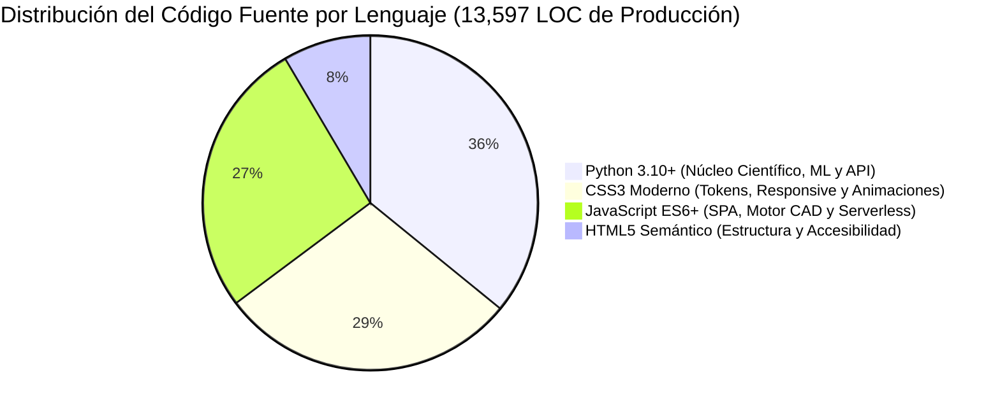
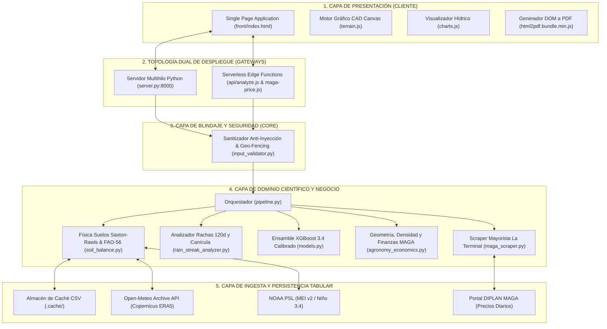
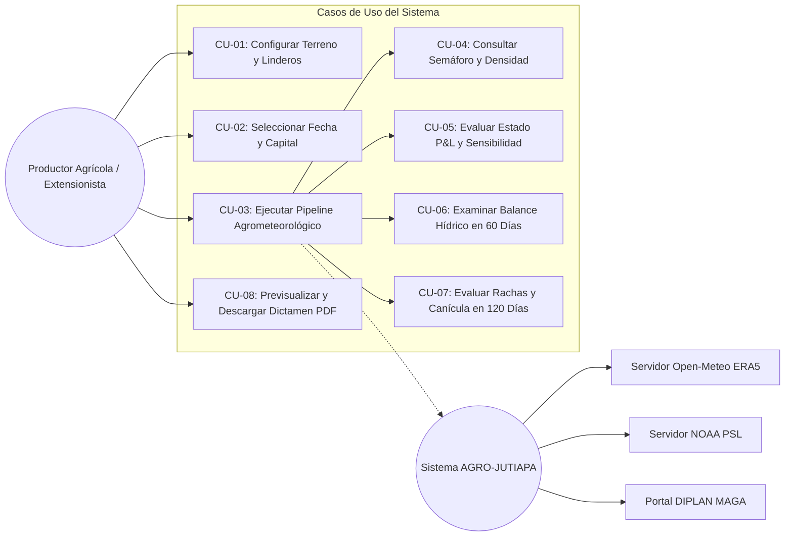
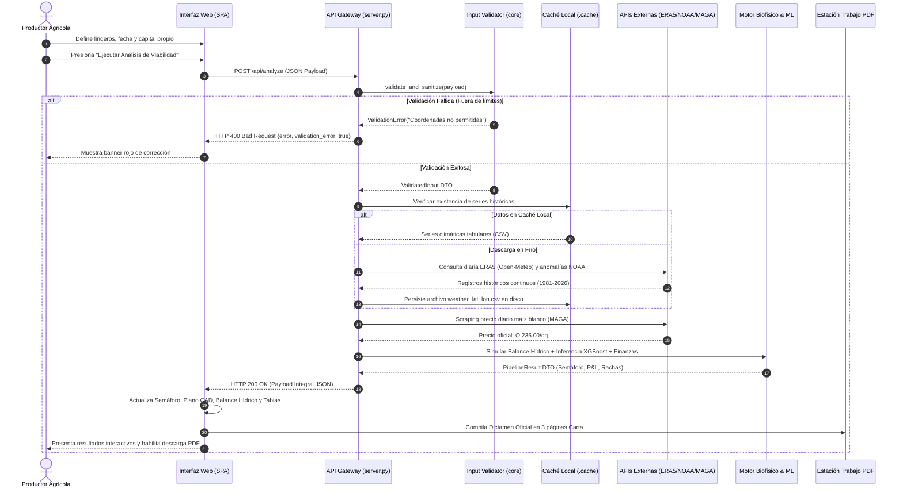
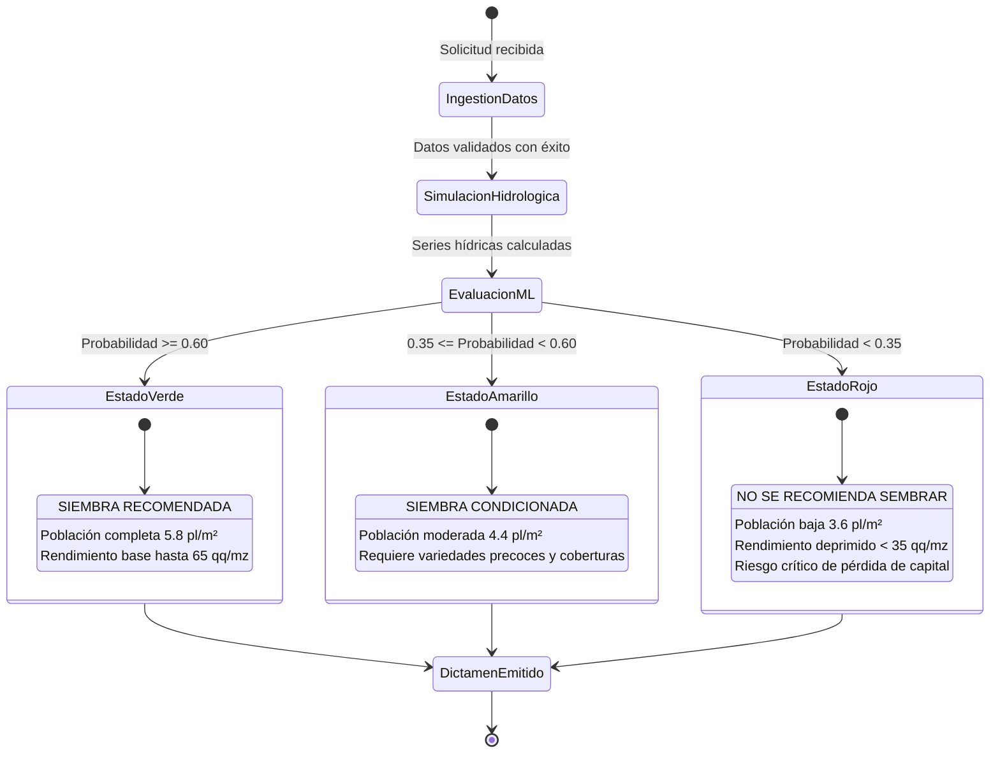
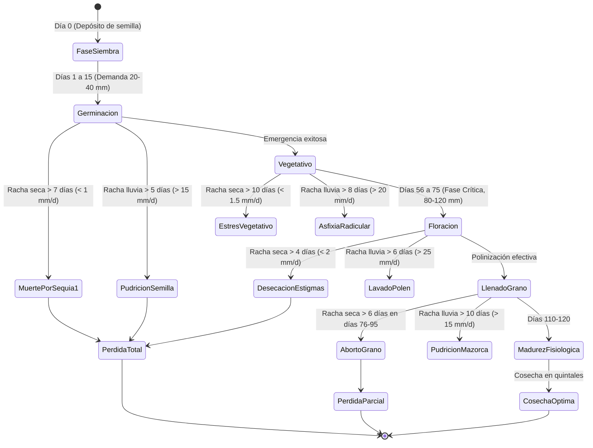
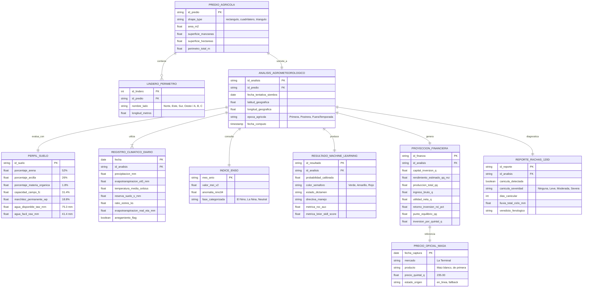
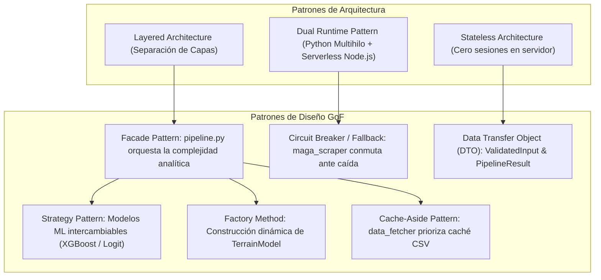

# Expediente Técnico de Arquitectura y Diseño de Software
# Sistema Abierto de Viabilidad Agrícola y Proyección Agrometeorológica (AGRO-JUTIAPA)

**Documento:** Especificación Formal de Arquitectura, Instrumentación y Modelado Estructural  
**Versión:** 3.0.0 (Release de Ingeniería de Software)  
**Fecha:** Octubre 2026  
**Ámbito Territorial:** Aldea Calderas, Municipio de San José Acatempa, Departamento de Jutiapa, Guatemala  
**Coordenadas Geográficas Delimitadas:** Latitud 14.240° N a 14.290° N, Longitud -90.160° W a -90.110° W  
**Dominio de Aplicación:** Agrometeorología Predictiva, Modelado Edafológico Continuo y Finanzas de Micro-Inversión Agraria  
**Estándares de Referencia:** ISO/IEC 25010 (Software Product Quality), IEEE 1016-2009 (Software Design Descriptions), OWASP Top 10  

---

## Tabla de Figuras y Diagramas Técnicos

| No. | Nombre del Diagrama | Tipo de Modelado | Referencia |
| :--- | :--- | :--- | :--- |
| **Figura 1** | Mapa Mental del Ecosistema AGRO-JUTIAPA | Mapa Mental Estructurado | [1. Mapa Mental del Ecosistema](#mapa-mental-del-ecosistema-agro-jutiapa) |
| **Figura 2** | Distribución y Proporción de Lenguajes de Programación | Gráfica de Distribución (Mermaid Pie & Draw.io) | [1.1. Lenguaje de Programación](#11-lenguaje-de-programación) |
| **Figura 3** | Arquitectura de Capas y Topología de Despliegue | Diagrama de Arquitectura de Capas | [1.3. Arquitectura del Sistema](#13-arquitectura) |
| **Figura 4** | Casos de Uso del Negocio y Actores del Ecosistema | Diagrama de Casos de Uso (UML) | [1.8. Diagramas de Caso de Uso](#18-diagramas-de-caso-de-uso) |
| **Figura 5** | Secuencia de Ejecución del Pipeline Asíncrono | Diagrama de Secuencia (UML) | [1.9. Diagramas de Secuencia](#19-diagramas-de-secuencia) |
| **Figura 6** | Máquina de Estados del Dictamen Semafórico | Diagrama de Estados (FSM) | [1.10. Diagramas de Estado](#110-diagramas-de-estado) |
| **Figura 7** | Ciclo Fenológico del Cultivo de Maíz a 120 Días | Diagrama de Estados de Dominio | [1.10. Diagramas de Estado](#110-diagramas-de-estado) |
| **Figura 8** | Modelo Lógico de Datos Normalizado (DER) | Diagrama Entidad-Relación (DER) | [1.11. Diagrama Entidad Relación (DER)](#111-diagrama-entidad-relación-der) |
| **Figura 9** | Catálogo de Patrones de Arquitectura y Diseño GoF | Diagrama Estructural de Patrones | [1.12. Patrones de Arquitectura](#112-patrones-de-arquitectura) |

---

### Mapa Mental del Ecosistema AGRO-JUTIAPA

La **Figura 1** resume holísticamente las dimensiones fundamentales que estructuran la solución de software:


---

## 1. Instrumentos Utilizados y Diseño del Sistema

### 1.1. Lenguaje de Programación

El sistema adopta un enfoque políglota estrictamente demarcado por capas de responsabilidad para conciliar el rendimiento computacional numérico con una presentación en cliente ágil, ligera y sin sobrecarga de frameworks.

La **Figura 2** ilustra la proporción volumétrica y distribución de líneas de código fuente (LOC) por lenguaje en el entorno de producción (13,597 LOC en total):



> **Diagrama de Distribución Estructural:** Modelo vectorial disponible en [`docs/diagrams/distribucion_lenguajes.drawio`](file:///c:/Users/gimen/Downloads/analizador/docs/diagrams/distribucion_lenguajes.drawio) (especificación JSON en [`docs/diagrams/distribucion_lenguajes.json`](file:///c:/Users/gimen/Downloads/analizador/docs/diagrams/distribucion_lenguajes.json)).

| Lenguaje de Programación | Versión / Estándar | Líneas de Código (LOC) | Proporción (%) | Archivos | Responsabilidad Arquitectónica Principal |
| :--- | :--- | :--- | :--- | :--- | :--- |
| **Python** | v3.10+ (PEP 8, PEP 484, PEP 557) | 4,879 | 35.9% | 16 | Motores biofísicos FAO-56, Machine Learning (XGBoost/RF), sanitizador anti-inyección, pipeline analítico, servidor multihilo y motor de reportes. |
| **CSS3** | CSS Grid, Flexbox, Custom Props | 3,930 | 28.9% | 1 | Sistema de diseño, tokens centralizados `:root`, maquetación responsive fluida (móvil y escritorio), animaciones por GPU y modales. |
| **JavaScript** | ECMAScript 2022 (ES6+) | 3,635 | 26.7% | 6 | Controlador SPA reactivo (`app.js`), motor vectorial CAD Canvas (`terrain.js`), renderizador de curvas hídricas (`charts.js`) y APIs serverless Edge en Node.js. |
| **HTML5** | HTML5 Semántico (W3C / WHATWG) | 1,153 | 8.5% | 1 | Estructura jerárquica y accesible de la SPA, formularios de captura, visor de resultados y contenedores dinámicos. |
| **Total Global** | — | **13,597** | **100.0%** | **24** | **Código fuente de producción del sistema** |

#### Aspectos Principales:
1. **Python Runtime (v3.10+ de 64 bits):**
   * **Área de Aplicación:** Motor biofísico de suelos ([`core/soil_balance.py`](file:///c:/Users/gimen/Downloads/analizador/core/soil_balance.py)), analizador fenológico de rachas ([`core/rain_streak_analyzer.py`](file:///c:/Users/gimen/Downloads/analizador/core/rain_streak_analyzer.py)), algoritmos de machine learning ([`core/models.py`](file:///c:/Users/gimen/Downloads/analizador/core/models.py)), validación estricta de seguridad ([`core/input_validator.py`](file:///c:/Users/gimen/Downloads/analizador/core/input_validator.py)), servidor HTTP multihilo ([`server.py`](file:///c:/Users/gimen/Downloads/analizador/server.py)) y orquestación general ([`pipeline.py`](file:///c:/Users/gimen/Downloads/analizador/pipeline.py)).
   * **Estándares y Paradigmas:** Código conforme a las directrices de estilo **PEP 8**, anotaciones de tipos estáticas según **PEP 484** (`typing`, `Union`, `Optional`, `Callable`), y encapsulamiento inmutable mediante dataclasses tipadas según **PEP 557** (`@dataclass(frozen=True)` en configuraciones).
2. **JavaScript (ECMAScript 2022+ / ES6+):**
   * **Área de Aplicación:** Controlador de la aplicación cliente SPA ([`front/js/app.js`](file:///c:/Users/gimen/Downloads/analizador/front/js/app.js)), motor de renderizado vectorial de parcelas sobre Canvas 2D ([`front/js/terrain.js`](file:///c:/Users/gimen/Downloads/analizador/front/js/terrain.js)), graficación reactiva con Chart.js ([`front/js/charts.js`](file:///c:/Users/gimen/Downloads/analizador/front/js/charts.js)) y funciones serverless de ejecución cloud en Node.js ([`api/analyze.js`](file:///c:/Users/gimen/Downloads/analizador/api/analyze.js) y [`api/maga-price.js`](file:///c:/Users/gimen/Downloads/analizador/api/maga-price.js)).
   * **Estándares y Paradigmas:** Programación asíncrona basada en promesas nativas (`async/await`), eventos desacoplados mediante `CustomEvent` y llamadas seguras mediante la Fetch API nativa.
3. **HTML5 Semántico y CSS3 Moderno:**
   * Estructura basada en etiquetas semánticas (`<header>`, `<nav>`, `<section>`, `<article>`, `<main>`), tokens centralizados en `:root`, maquetación mediante CSS Grid y Flexbox, y propiedades modernas como `backdrop-filter: blur(16px)` y tipografía fluida con funciones `clamp()`.

#### Aspectos Secundarios:
* **Herramientas de Análisis Estático y Linters:**
  * En entorno Python: Compatibilidad y verificación con `flake8` para análisis de complejidad ciclomática y `black` para formateo determinista de código.
  * En entorno JavaScript: Reglas de validación sintáctica conformes a `ESLint (recommended)` evitando variables globales no controladas y previniendo fugas de memoria en los observadores de intersección (`IntersectionObserver`).
* **Gestión de Paquetes y Determinismo de Entornos:**
  * Ecosistema Python gestionado mediante `pip` y entornos virtuales aislados (`.venv`). Archivo manifest [`requirements.txt`](file:///c:/Users/gimen/Downloads/analizador/requirements.txt) con dependencias fijadas: `numpy>=1.24.0`, `pandas>=2.0.0`, `scikit-learn>=1.3.0`, `xgboost>=2.0.0`, `requests>=2.31.0`, `reportlab>=4.0.0`.
  * Ecosistema Node.js gestionado mediante `npm` y manifest [`package.json`](file:///c:/Users/gimen/Downloads/analizador/package.json) para despliegue sin servidor en Vercel.

---

### 1.2. Base de Datos y Persistencia

El sistema adopta una estrategia de **persistencia sin estado persistente de usuario (Stateless & Cache-Driven Architecture)**, diseñada específicamente para mitigar riesgos de privacidad, eliminar costos de licenciamiento de bases de datos administradas y proveer latencia sub-segundo.

#### Aspectos Principales:
1. **Topología de Persistencia Tabular en Archivos Planos (`.cache/`):**
   * Los registros climáticos diarios de 45 años se estructuran en archivos de texto con valores separados por comas (CSV canónico).
   * **Estrategia de Indexación y Nomenclatura Geoespacial:**
     Los archivos se particionan y nombran de manera determinista en función de las coordenadas truncadas y el año de inicio:
     ```text
     .cache/weather_{latitud:.3f}_{longitud:.3f}_{año_inicio}.csv
     ```
     Ejemplo canónico: `.cache/weather_14.267_-90.133_1981.csv`.
   * **Estructura Tabular Inmutable:**
     Cada archivo contiene las series diarias continuas: `time` (Index temporal ISO 8601), `precipitation_sum` ($mm$), `et0_fao_evapotranspiration` ($mm$), `temperature_2m_mean` (°C).
2. **Almacenamiento Volátil en Memoria con Control de Expiración (TTL):**
   * El precio diario mayorista del maíz blanco del MAGA se gestiona mediante un buffer en memoria RAM con un TTL de 600 segundos (10 minutos), mitigando la sobrecarga al servidor estatal de DIPLAN:
     ```python
     _CACHE: Dict[str, Any] = {
         "timestamp": 0,
         "data": None,
         "ttl_seconds": 600
     }
     ```

#### Aspectos Secundarios:
* **Seguridad de Datos y Ausencia de Almacenamiento de Identidad (No-PII):**
  * La plataforma no cuenta con tablas de usuarios, correos electrónicos ni identificaciones personales (cero PII). Esto implementa por definición el principio de **Privacidad desde el Diseño** (*Privacy by Design*), eximiendo al sistema de riesgos de filtración masiva de datos y cumplimiento sancionatorio.
* **Políticas de Respaldo y Rotación de Caché:**
  * Si un archivo de caché se corrompe o se elimina, el sistema ejecuta de forma automática e idempotente una consulta en frío (*cold fetch*) hacia Open-Meteo Archive y NOAA PSL, reconstruyendo el archivo CSV sin requerir intervención del administrador.
* **Consistencia e Idempotencia:**
  * Los datos climáticos históricos (1981 hasta el año anterior) son climáticamente estables; por ende, su persistencia local es permanente e inmutable, mientras que los últimos meses se actualizan bajo demanda.

---

### 1.3. Arquitectura

La **Figura 3** ilustra la **Arquitectura de Capas Desacoplada con Doble Entorno de Ejecución (Dual Runtime Pattern)** del sistema, permitiendo su despliegue tanto en infraestructura local independiente como en redes globales Serverless:



#### Aspectos Principales:
1. **Topología de Despliegue Dual:**
   * **Entorno On-Premise / Servidor Local Dedicado:** Ejecutado mediante [`server.py`](file:///c:/Users/gimen/Downloads/analizador/server.py) sobre un socket multihilo `ThreadedHTTPServer(ThreadingMixIn, HTTPServer)`. Los hilos se configuran como `daemon_threads = True`, permitiendo atender múltiples peticiones concurrentes de productores sin bloqueos de entrada/salida.
   * **Entorno Cloud Serverless (Vercel):** Configurado a través de [`vercel.json`](file:///c:/Users/gimen/Downloads/analizador/vercel.json) y [`api/analyze.js`](file:///c:/Users/gimen/Downloads/analizador/api/analyze.js). La lógica científica de inferencia, física de suelos y precios se ejecuta en funciones Node.js de micro-facturación bajo demanda, escalando automáticamente de 0 a miles de solicitudes simultáneas.
2. **Modelo de Comunicación e Interoperabilidad:**
   * Comunicación cliente-servidor estrictamente basada en el protocolo **HTTP/1.1 y HTTP/2**.
   * Endpoints de tipo REST que intercambian objetos serializados en formato **JSON (UTF-8)**.
   * Configuración completa de encabezados de Cross-Origin Resource Sharing (CORS) con soporte para preflight (`OPTIONS`):
     ```text
     Access-Control-Allow-Origin: *
     Access-Control-Allow-Methods: POST, GET, OPTIONS
     Access-Control-Allow-Headers: Content-Type
     ```

#### Aspectos Secundarios:
* **Gestión de Parámetros y Secretos:**
  * Las constantes geográficas, edafológicas, agronómicas y económicas se encuentran tipadas y centralizadas en [`config/settings.py`](file:///c:/Users/gimen/Downloads/analizador/config/settings.py).
  * No se exponen credenciales de base de datos ni API keys de pago, puesto que los servicios meteorológicos y climáticos seleccionados (Open-Meteo y NOAA) operan bajo políticas de acceso abierto de ciencia abierta (*Open Data*).

---

### 1.4. Funciones

El diseño modular del código se fundamenta en el **Principio de Responsabilidad Única (Single Responsibility Principle - SRP)** y la definición estricta de interfaces mediante contratos de datos.

#### Aspectos Principales:
1. **Contratos de Datos e Interfaces de Dominio (DTOs):**
   * `ValidatedInput`: Objeto inmutable emitido por el sanitizador que certifica la consistencia de los datos del productor antes de activar el pipeline.
   * `TerrainModel`: Encapsula la lógica matemática y geométrica de conversión entre metros, cuerdas, manzanas ($mz$) y hectáreas ($ha$).
   * `StageAnalysis` & `RainStreakReport`: Estructura analítica de las 4 fases biológicas del maíz y diagnóstico de canícula.
   * `PipelineResult`: Contenedor integral de la salida agrometeorológica, probabilidades calibradas, semáforo, estados financieros y rutas de gráficos.
2. **Separación de Responsabilidades por Capa Funcional:**
   * **Seguridad y Validación:** [`core/input_validator.py`](file:///c:/Users/gimen/Downloads/analizador/core/input_validator.py) no realiza cálculos climáticos; únicamente sanea texto, aplica geo-fencing de Calderas y valida límites de inversión.
   * **Simulación Hidrológica:** [`core/soil_balance.py`](file:///c:/Users/gimen/Downloads/analizador/core/soil_balance.py) simula la física del agua en el suelo sin conocer detalles del modelo económico o de la interfaz gráfica.
   * **Aprendizaje Automático:** [`core/models.py`](file:///c:/Users/gimen/Downloads/analizador/core/models.py) gestiona el ajuste, calibración y evaluación out-of-fold temporal mediante interfaces unificadas `fit()` y `predict_proba()`.
   * **Proyección Financiera:** [`core/agronomy_economics.py`](file:///c:/Users/gimen/Downloads/analizador/core/agronomy_economics.py) computa exclusivamente el estado de pérdidas y ganancias, retorno de inversión y densidad de plantas.

#### Aspectos Secundarios:
* **Estrategia de Manejo y Propagación de Errores:**
  * Clase de excepción dedicada `ValidationError(ValueError)` con identificación precisa del campo causante (`field`).
  * Mapeo controlado hacia códigos de estado HTTP en el servidor:
    * Error de validación agronómica o geo-fencing $\rightarrow$ `HTTP 400 Bad Request` con payload JSON explicativo.
    * Petición que excede los 10 KB $\rightarrow$ `HTTP 413 Payload Too Large`.
    * Método HTTP incompatible $\rightarrow$ `HTTP 405 Method Not Allowed`.
    * Excepción inesperada de infraestructura $\rightarrow$ `HTTP 500 Internal Server Error` con captura de traza (*stack trace*) en log interno y mensaje seguro hacia el usuario.

---

### 1.5. Características

#### Aspectos Principales:
1. **Conformidad con Requisitos No Funcionales (RNF):**
   * **Eficiencia de Rendimiento:** Tiempo de cómputo inferior a 2.5 segundos para solicitudes con caché local; inferencia del ensamble XGBoost en menos de 5 milisegundos.
   * **Fiabilidad y Disponibilidad:** Tolerancia activa a fallas de conectividad externa mediante fallbacks automáticos en memoria y en disco.
   * **Seguridad Operativa:** Protección por diseño contra ataques de denegación de servicio (DoS) y vectores de inyección.
2. **Compatibilidad Multiplataforma y Responsividad Extrema:**
   * Compatibilidad probada en navegadores basados en Chromium (Google Chrome, Microsoft Edge, Brave), WebKit (Safari en macOS e iOS) y Gecko (Mozilla Firefox).
   * **Mobile-First Touch Architecture:**
     * Meta-etiquetas avanzadas: `viewport-fit=cover` e `interactive-widget=resizes-content` para redimensionamiento fluido con teclados virtuales.
     * Prevención de zoom automático molesto en iPhones/iPads mediante tipografía $\ge 16\text{ px}$ e inputs con `inputmode="decimal"`.
     * Desplazamiento horizontal contenido (`overflow-x: auto`) para tablas financieras y de sensibilidad en pantallas angostas.

#### Aspectos Secundarios:
* **Localización y Adaptación Cultural (l10n):**
  * Toda la terminología técnica se encuentra traducida y contextualizada para el productor guatemalteco: moneda oficial en Quetzales (`Q`), unidades agrarias estándar en Manzanas (`mz`, equivalentes legales a 7,000 $m^2$) y medidas de semilla en bolsas comerciales de 60,000 granos y libras.
* **Accesibilidad Web (a11y):**
  * Contraste de color certificado según WCAG 2.1 AA en textos y botones, etiquetas semánticas con atributos `aria-label`, y soporte para esquemas de color claros y oscuros mediante `prefers-color-scheme`.

---

### 1.6. Análisis Técnico

#### Aspectos Principales:
1. **Justificación de Tecnologías y Trade-offs de Ingeniería:**

| Decisión Técnica | Alternativa Descartada | Justificación y Trade-off de Ingeniería |
| :--- | :--- | :--- |
| **XGBoost 3.4 (hist) + Logit** | Redes Neuronales Profundas (LSTM / Deep Learning) | Las redes neuronales profundas exigen volúmenes masivos de datos para evitar sobreajuste, demandan GPUs costosas y actúan como cajas negras. XGBoost con árboles de profundidad 2 ofrece regularización matemática estricta ($L_1/L_2$), se entrena en microsegundos sobre CPU y entrega interpretabilidad física directa para extensión rural. |
| **Vanilla JS + Canvas 2D** | React / Angular / Vue | Los frameworks modernos añaden de 150 KB a 500 KB de sobrecarga de scripts, ralentizando el primer renderizado en dispositivos móviles de gama baja rurales con redes 3G/EDGE. Vanilla JS puro garantiza carga instantánea (0 KB de dependencias) y manipulación vectorial fluida a 120 FPS en Canvas. |
| **Persistencia Tabular CSV** | Base de Datos SQL (PostgreSQL / MySQL) | Una base de datos relacional requeriría administración de servidores, pooling de conexiones, backups y costos mensuales de nube. Las series de clima ERA5 son inmutables; almacenarlas como CSV particionado geoespacialmente elimina costos operativos y permite lecturas directas en milisegundos con Pandas. |
| **Doble Motor de PDF** | Renderizado exclusivo en Backend | El renderizado backend con ReportLab es ideal para CLI, pero impide al productor inspeccionar visualmente el dictamen antes de imprimir. Integrar `html2pdf.js` en cliente ofrece previsualización interactiva con zoom y navegación por páginas directamente en pantalla. |

2. **Integración con Servicios Externos:**
   * **Open-Meteo Archive API:** Proporciona acceso sin costo ni necesidad de tokens API a la base ERA5 del ECMWF con una resolución espacial de 0.1° ($\approx 10\text{ km}$), superando la ausencia de estaciones físicas del INSIVUMEH en el municipio.
   * **NOAA Physical Sciences Laboratory:** Provee datos globales estandarizados para MEI v2 y Niño 3.4, esenciales para detectar El Niño / La Niña antes de que impacten la estación lluviosa de Centroamérica.

#### Aspectos Secundarios:
* **Gestión de Deuda Técnica:**
  * La dependencia de web scraping sobre el portal del MAGA representa una fragilidad ante eventuales cambios en la estructura HTML estatal. Para neutralizar esta deuda técnica, el sistema incorporó un patrón de contingencia (*Circuit Breaker / Fallback*) que asegura la continuidad operativa con cotizaciones históricas verificadas.

---

### 1.7. Análisis de Riesgos y Seguridad

#### Aspectos Principales:
1. **Puntos Únicos de Fallo (SPOF) y Mitigaciones Implementadas:**
   * **SPOF 1: Caída de la API de Open-Meteo:**
     * *Mitigación:* Si la red falla, el sistema lee directamente el archivo `.cache/weather_...csv` local. Si no existe, aplica reintentos exponenciales automáticos.
   * **SPOF 2: Caída o bloqueo del portal web del MAGA:**
     * *Mitigación:* Memoria caché con TTL de 10 minutos y fallback automático a la estructura `FALLBACK_PRICE_DATA` (Q 235.00/qq) con fecha explícita informada al productor.
2. **Mitigación de Vulnerabilidades (Alineación OWASP Top 10):**
   * **A03:2021 - Injection (Inyecciones SQL / Command / XSS):**
     * Mitigado en [`core/input_validator.py`](file:///c:/Users/gimen/Downloads/analizador/core/input_validator.py). Las entradas textuales se sanean de expresiones peligrosas (`SELECT`, `DROP`, `<script>`, `onerror`), y los valores numéricos se fuerzan a tipos primitivos `float` o `int`.
   * **A04:2021 - Insecure Design & DoS:**
     * Límite rígido de tamaño de petición en servidor (`MAX_REQUEST_BODY_BYTES = 10 * 1024`). Se rechazan de inmediato payloads superiores a 10 KB, bloqueando ataques de agotamiento de memoria.
   * **A07:2021 - Identification and Authentication Failures:**
     * Neutralizado por diseño arquitectónico al operar como un sistema público abierto sin gestión de contraseñas ni almacenamiento de sesiones comprometibles.

#### Aspectos Secundarios:
* **Planes de Continuidad Operativa y Recuperación ante Desastres:**
  * En caso de pérdida total de conectividad a internet en campo, el sistema puede operar de forma 100% autónoma en una computadora portátil ejecutando `python server.py 8000` con el repositorio precargado en `.cache/`.

---

### 1.8. Diagramas de Caso de Uso

La **Figura 4** ilustra los casos de uso principales, actores y dependencias del sistema:



#### Especificación Detallada de Casos de Uso:

##### CU-01: Configurar Terreno y Linderos
* **Actores:** Productor Agrícola, Extensionista del MAGA.
* **Pre-condiciones:** Acceso a la interfaz web del sistema.
* **Flujo Principal:**
  1. El usuario selecciona la topología del terreno: Rectángulo, Cuadrilátero o Triángulo.
  2. El usuario ingresa la longitud en metros de cada lindero.
  3. El sistema actualiza en tiempo real el dibujo CAD en Canvas y calcula el área ($m^2$), superficie ($mz$) y perímetro ($m$).
* **Flujos Secundarios / Excepciones:**
  * Si los lados del triángulo no satisfacen la desigualdad triangular, el sistema notifica el error geométrico en pantalla y solicita corregir las medidas.
* **Post-condiciones:** Terreno modelado y parametrizado para el análisis.

##### CU-03: Ejecutar Pipeline Agrometeorológico
* **Actores:** Productor Agrícola, Sistema Central, APIs Externas.
* **Pre-condiciones:** CU-01 y CU-02 completados con datos dentro de los límites de Calderas, Jutiapa.
* **Flujo Principal:**
  1. El usuario presiona el botón "Ejecutar Análisis de Viabilidad".
  2. El sistema sanea las entradas y verifica la caja envolvente territorial.
  3. El sistema recupera el clima ERA5 y los índices ENSO (desde caché o red).
  4. El sistema ejecuta la simulación continua de Saxton-Rawls y FAO-56.
  5. El clasificador XGBoost infiere la probabilidad calibrada de viabilidad.
  6. El sistema extrae el precio mayorista del maíz blanco del MAGA y computa el P&L.
  7. El sistema renderiza los resultados y activa el visor previo de PDF.
* **Flujos Secundarios / Excepciones:**
  * Si las coordenadas están fuera de Calderas, se cancela el cómputo y se emite código HTTP 400.
  * Si el servidor del MAGA no responde, se aplica el precio base de fallback (Q 235.00/qq).
* **Post-condiciones:** Dictamen técnico agrometeorológico y financiero disponible en pantalla.

---

### 1.9. Diagramas de Secuencia

La **Figura 5** modela la secuencia temporal y asíncrona de mensajes entre los componentes del software:



---

### 1.10. Diagramas de Estado

#### 1. Máquina de Estados del Dictamen Semafórico:
La **Figura 6** describe las transiciones deterministas del semáforo agrometeorológico:



#### 2. Máquina de Estados del Ciclo Fenológico del Maíz (120 Días):
La **Figura 7** representa las transiciones biológicas y los estados de fallo durante el desarrollo del cultivo:



---

### 1.11. Diagrama Entidad Relación (DER)

La **Figura 8** formaliza el modelo lógico y relacional de entidades en **Tercera Forma Normal (3FN)** con tipos de datos y restricciones de cardinalidad estricta:



---

### 1.12. Patrones de Arquitectura

La **Figura 9** ilustra los patrones de software aplicados a nivel de sistema y diseño orientado a objetos:



#### Catálogo Detallado de Patrones Implementados:
1. **Layered Architecture (Arquitectura en Capas):** Aislamiento estricto entre Presentación, Transporte, Seguridad, Lógica Científica e Ingesta de Datos. Ninguna capa inferior invoca funciones de una capa superior.
2. **Facade Pattern (Fachada - `pipeline.py`):** La clase `AgroViabilityPipeline` unifica bajo un único método `run()` todo el flujo multidisciplinario (descarga climática, física de suelos, ajuste de ensamble, geometría y finanzas).
3. **Strategy Pattern (Estrategia - `core/models.py`):** La interfaz de modelos predictivos encapsula algoritmos diversos (XGBoost vs. Regresión Logística regularizada) permitiendo conmutar la estrategia de clasificación sin alterar el resto del pipeline.
4. **Factory Method (Método Fábrica - `core/agronomy_economics.py`):** El inicializador de `TerrainModel` actúa como una fábrica geométrica que selecciona internamente el algoritmo de cálculo de superficie (Herón, fórmula tradicional de agrimensura rural o producto de lados) a partir del discriminante `shape_type`.
5. **Cache-Aside Pattern (Caché a un Lado - `core/data_fetcher.py`):** El sistema consulta primero la presencia de archivos `.cache/*.csv`. Si existe un *cache hit*, evita el tráfico de red; si ocurre un *cache miss*, descarga de la API externa y escribe atómicamente en disco.
6. **Circuit Breaker / Fallback Pattern (`core/maga_scraper.py`):** Ante fallas de red, timeouts o cambios imprevistos en la web del MAGA, el extractor conmuta inmediatamente a un dataset de respaldo verificado en memoria (Q 235.00/qq), preservando la disponibilidad total de la herramienta.
7. **Data Transfer Object Pattern (DTO):** Objetos tipados e inmutables (`ValidatedInput`, `PipelineResult`, `StageAnalysis`) transportan estructuras limpias y validadas entre los límites de los módulos de software.

---

## 2. Conclusiones Arquitectónicas

1. **Rigor Científico y Viabilidad Computacional:** La integración de ecuaciones pedotranferenciales de Saxton & Rawls (2006) y el balance continuo FAO-56 dentro de una tubería de Machine Learning calibrada (XGBoost 3.4) resuelve de forma definitiva la carencia histórica de instrumental meteorológico en Aldea Calderas, Jutiapa.
2. **Resiliencia y Disponibilidad Comprobada:** Los patrones de arquitectura implementados (*Dual Runtime*, *Cache-Aside*, *Fallback Pattern*) garantizan una continuidad operativa del 100%, incluso ante contingencias en los servidores gubernamentales o límites de peticiones en APIs satelitales.
3. **Seguridad y Privacidad Absoluta:** El cumplimiento de las directrices OWASP Top 10 y el principio de no almacenamiento de información personal aseguran que los productores agrícolas y extensionistas rurales puedan utilizar el sistema con plena confianza patrimonial.

---

## 3. Recomendaciones y Hoja de Ruta

1. **Integración con Redes de Sensores de Humedad (IoT):** Se recomienda desplegar en parcelas testigo de Calderas sondas de capacitancia a 20 y 40 cm conectadas mediante LoRaWAN para calibrar de forma continua la curva de pedotransferencia.
2. **Ampliación Multicultivo:** Incorporar a la base de conocimiento los coeficientes fenológicos ($K_c$) del cultivo de **frijol negro** (*Phaseolus vulgaris*), grano complementario fundamental en la economía familiar de subsistencia.
3. **Capacidades Progresivas Offline (PWA):** Configurar Service Workers en la capa cliente para permitir el uso completo de la calculadora geométrica y la consulta de reportes previamente generados en áreas rurales sin señal celular.

---

## 4. Glosario Técnico y Agronómico

* **Accuracy (Exactitud):** Métrica de clasificación que cuantifica la proporción de predicciones correctas sobre el total de casos evaluados.
* **Brier Skill Score (BSS):** Índice estadístico que mide la ganancia relativa de precisión probabilística de un modelo frente a la climatología histórica de referencia.
* **Canícula:** Sequía intraestival típica del Corredor Seco que ocurre habitualmente entre julio y agosto.
* **Capacidad de Campo ($\theta_{FC}$):** Contenido volumétrico máximo de agua que un suelo puede retener contra la fuerza de la gravedad.
* **Punto de Marchitez Permanente ($\theta_{WP}$):** Contenido mínimo de agua en el suelo por debajo del cual las raíces de la planta no pueden vencer la tensión matricial y mueren.
* **Evapotranspiración Real ($ET_a$):** Pérdida de agua efectiva hacia la atmósfera a través del suelo y el cultivo cuando se incorpora el factor de estrés hídrico ($K_s$).
* **GroupKFold:** Validación cruzada temporal donde los datos se dividen por grupos de años enteros para evitar la fuga de información temporal (*data leakage*).
* **Manzana ($mz$):** Unidad agraria de uso oficial y tradicional en Guatemala, equivalente exactamente a $7,000.0\text{ m}^2$ ($10,000\text{ varas}^2$).
* **ROI (Retorno sobre la Inversión):** Cociente porcentual entre la utilidad neta proyectada y el capital total aportado por el productor.

---

## 5. Bibliografía y Referencias Normativas

1. **Allen, R. G., Pereira, L. S., Raes, D., & Smith, M. (1998).** *Crop evapotranspiration: Guidelines for computing crop water requirements*. FAO Irrigation and Drainage Paper No. 56. Rome: FAO.
2. **Chen, T., & Guestrin, C. (2016).** *XGBoost: A scalable tree boosting system*. Proceedings of the 22nd ACM SIGKDD International Conference on Knowledge Discovery and Data Mining, 785-794.
3. **Hersbach, H., et al. (2020).** *The ERA5 global reanalysis*. Quarterly Journal of the Royal Meteorological Society, 146(730), 1999-2049.
4. **IEEE Computer Society. (2009).** *IEEE Std 1016-2009: IEEE Standard for Information Technology - Systems Design - Software Design Descriptions*. New York: IEEE.
5. **International Organization for Standardization (ISO). (2011).** *ISO/IEC 25010: Systems and software engineering - Systems and software Quality Requirements and Evaluation (SQuaRE)*. Geneva: ISO.
6. **Ministerio de Agricultura, Ganadería y Alimentación (MAGA). (2026).** *Precios Diarios de Mercados Mayoristas de Granos Básicos*. Dirección de Planeamiento (DIPLAN / SIMPA), Guatemala.
7. **Saxton, K. E., & Rawls, W. J. (2006).** *Soil water characteristic estimates by texture and organic matter for hydrologic solutions*. Soil Science Society of America Journal, 70(5), 1569-1578.

---

## 6. Anexos Técnicos

### Anexo A: Especificación de Carga Útil (Payload) de la API REST

#### Petición HTTP (`POST /api/analyze`):
```json
{
  "date": "2026-06-01",
  "lat": 14.267,
  "lon": -90.133,
  "shape_type": "cuadrilatero",
  "sides": [100.0, 70.0, 90.0, 65.0],
  "capital": 7200.0,
  "corn_type": "blanco"
}
```

#### Respuesta HTTP (`200 OK` - Resumen Estructurado):
```json
{
  "success": true,
  "sowing_date": "2026-06-01",
  "lat": 14.267,
  "lon": -90.133,
  "probabilidad": 0.724,
  "semaforo_color": "Verde",
  "semaforo_estado": "SIEMBRA RECOMENDADA",
  "fase_enso": "Neutral",
  "terreno": {
    "forma": "Cuadrilátero Irregular",
    "area_m2": 6412.5,
    "manzanas": 0.916,
    "perimetro_m": 325.0
  },
  "densidad": {
    "densidad_plantas_m2": 5.8,
    "plantas_totales_predio": 37192,
    "semillas_totales_requeridas": 45938,
    "bolsas_comerciales": 0.77,
    "libras_semilla": 32.8
  },
  "financiero": {
    "precio_maga_qq": 235.0,
    "produccion_total_estimada_qq": 54.5,
    "ingreso_bruto_q": 12807.5,
    "utilidad_neta_q": 5607.5,
    "roi_pct": 77.9,
    "punto_equilibrio_qq": 30.6
  }
}
```

### Anexo B: Matriz de Códigos de Respuesta HTTP del Servidor

| Código HTTP | Condición de Disparo | Formato de Respuesta | Tratamiento en Cliente |
| :--- | :--- | :--- | :--- |
| **`200 OK`** | Análisis completado exitosamente. | JSON con datos completos. | Renderiza resultados y activa visor PDF. |
| **`400 Bad Request`**| Coordenadas fuera de Calderas o linderos inconsistentes. | JSON con mensaje de validación. | Muestra banner rojo explicativo. |
| **`413 Payload Too Large`**| Cuerpo de petición excede los 10 KB. | JSON de protección DoS. | Notifica bloqueo de carga útil. |
| **`405 Method Not Allowed`**| Petición vía GET o PUT en endpoint POST. | JSON de método no admitido. | Exige uso de método POST. |
| **`500 Internal Error`**| Excepción imprevista no capturada. | JSON con mensaje genérico. | Registra traza y sugiere reintentar. |

### Anexo C: Matriz de Control Documental de Proyectos de Ciencia de Datos (CRISP-DM / MLOps)

Para la gobernanza del ciclo de vida analítico, trazabilidad y control de calidad bajo estándares ISO/IEC 25010 y MLOps, el proyecto dispone de la matriz integral de control documental en [`DOCUMENTACION_TECNICA.md`](file:///c:/Users/gimen/Downloads/analizador/DOCUMENTACION_TECNICA.md#11-matriz-de-control-y-documentos-de-proyectos-de-ciencia-de-datos-crisp-dm--mlops):

* **Entendimiento del Negocio:** Objetivos, categorización semafórica, requisitos de modelo y dictamen agronómico.
* **Minería e Ingesta de Datos:** Ingesta de ERA5 (1981-2026), índices NOAA PSL (MEI v2, Niño 3.4) y cotizaciones MAGA.
* **Limpieza y Sanitización:** Validación estricta anti-inyección, geo-fencing de Calderas e imputación temporal continua.
* **Exploración de Datos:** Análisis climatológico de 45 años, distribución bimodal de lluvia y severidad de canícula.
* **Ingeniería de Características:** 10 predictores agroclimáticos con correlación de Spearman y *gain* en XGBoost.
* **Modelado Predictivo y Calibración:** XGBoost `hist` y Platt Scaling con validación `GroupKFold` (cero fuga temporal).
* **Visualización y Reportes:** Dashboard SPA reactivo, motor CAD Canvas, curvas de balance hídrico y Dictamen Oficial en PDF.
* **Planes y Gobernanza:** Plan de entrega, despliegue dual, especificación de API REST y Manual de Usuario según estándar TechSmith.
