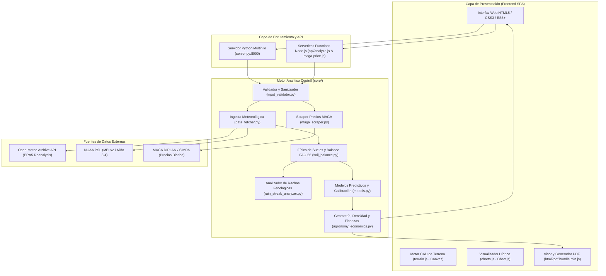

# Documentación Técnica de Arquitectura de Software
# Sistema Abierto de Viabilidad Agrícola y Proyección Agrometeorológica (AGRO-JUTIAPA)

**Documento:** Manual Técnico y Arquitectura de Software  
**Versión:** 2.5.0  
**Fecha:** Octubre 2026  
**Ámbito Geográfico Exclusivo:** Calderas, San José Acatempa, Jutiapa, Guatemala  
**Coordenadas Delimitadas:** Latitud $14.240^\circ\text{ N}$ a $14.290^\circ\text{ N}$, Longitud $-90.160^\circ\text{ W}$ a $-90.110^\circ\text{ W}$  
**Cultivo Específico:** Maíz Blanco de Primera (*Zea mays L.*)  
**Modalidad de Acceso:** Sistema Público y Abierto (Cero autenticación, sin credenciales)  

---

## 1. Visión General del Sistema y Contexto de Ingeniería

El **Sistema Abierto de Viabilidad Agrícola y Proyección Agrometeorológica** es una plataforma científica y financiera desarrollada para mitigar la vulnerabilidad agrícola en el Corredor Seco de Guatemala. Esta región presenta un régimen de precipitación altamente errático caracterizado por sequías intraestivales severas (*canículas* prolongadas entre julio y agosto) y una fuerte modulación por el fenómeno de El Niño-Oscilación del Sur (ENSO).

A diferencia de las herramientas convencionales basadas en valores estáticos o promedios climáticos simplificados, AGRO-JUTIAPA implementa un motor determinístico y probabilístico acoplado que:
1. Extrae y procesa series climáticas de reanálisis satelital de 45 años (1981–presente) a resolución diaria.
2. Simula la dinámica física de retención de humedad en el suelo con pedotransferencia validada empíricamente.
3. Evalúa la supervivencia del cultivo a lo largo de 120 días mediante un analizador de rachas pluviométricas por etapas fenológicas.
4. Entrena y calibra algoritmos de aprendizaje automático (XGBoost y Regresión Logística) mediante validación temporal agrupada por año (*no temporal leakage*).
5. Modela lotes agrícolas irregulares mediante algoritmos de agrimensura y renderizado CAD en tiempo real.
6. Proyecta el Estado de Pérdidas y Ganancias (P&L) en función del capital propio del productor y precios oficiales mayoristas del Ministerio de Agricultura, Ganadería y Alimentación (MAGA) obtenidos mediante scraping automatizado.
7. Emite un Dictamen Técnico Oficial maquetado en PDF de 3 páginas con visor de previsualización interactivo.

---

## 2. Arquitectura Global del Sistema

El sistema adopta una arquitectura de micro-servicios desacoplados con soporte para doble entorno de ejecución (**Dual Runtime**): ejecución local mediante un servidor HTTP multihilo en Python y ejecución serverless en la nube mediante Node.js en Vercel.



---

## 3. Especificación de Módulos del Núcleo (`core/`)

### 3.1. Validación y Blindaje contra Inyecciones (`core/input_validator.py`)
Este módulo constituye la primera línea de defensa del sistema. Implementa tipado fuerte con dataclasses y sanitización estricta antes de invocar cualquier cálculo.

#### Estructura de Datos de Entrada:
```python
@dataclass
class ValidatedInput:
    sowing_date: str
    lat: float
    lon: float
    shape_type: str
    sides: List[float]
    width: float
    length: float
    capital: float
    corn_type: str
    capital_warnings: List[str]
    capital_per_manzana: float
```

#### Reglas de Validación y Hardening:
1. **Límites Geográficos Exclusivos:**
   Rechaza cualquier coordenada que se encuentre fuera de la caja envolvente de Calderas, San José Acatempa:
   $$\text{Latitud} \in [14.240^\circ, 14.290^\circ], \quad \text{Longitud} \in [-90.160^\circ, -90.110^\circ]$$
2. **Sanitización de Cadenas de Texto (`sanitize_string`):**
   * Longitud máxima: 100 caracteres.
   * Filtro anti-XSS: Remoción recursiva de patrones `<script.*?>.*?</script>` y tags HTML generales `<[^>]+>`.
   * Filtro anti-SQLi: Supresión de palabras reservadas (`SELECT`, `DROP`, `INSERT`, `DELETE`, `UPDATE`, `UNION`), comentarios (`--`) y terminadores (`;`).
   * Filtro anti-Path Traversal: Supresión de secuencias `../`, `..\\`, `/` y `\\`.
3. **Consistencia Geométrica:**
   * Lados individuales entre $1.0\text{ m}$ y $2,000.0\text{ m}$.
   * Área total acotada a un máximo de $700,000.0\text{ m}^2$ ($100\text{ manzanas}$).
   * Desigualdad triangular estricta para terrenos de 3 lados: $a + b > c$, $a + c > b$, $b + c > a$.
4. **Validación Financiera de Capital:**
   * Mínimo absoluto: $\text{Q } 500.00$ (inversión mínima requerida para semilla y laboreo en minifundio).
   * Máximo admisible: $\text{Q } 150,000.00$.
   * Corredor histórico de suficiencia: $\text{Q } 2,000.00/\text{mz}$ a $\text{Q } 25,000.00/\text{mz}$. Si el capital se ubica fuera de este rango, genera advertencias diagnósticas no bloqueantes.

---

### 3.2. Ingesta y Caché de Datos Agrometeorológicos (`core/data_fetcher.py`)
Maneja la extracción y normalización de series climáticas satelitales y macroclimáticas.

#### Variables Diarias ERA5 (Open-Meteo):
* `precipitation_sum`: Precipitación acumulada en 24 horas ($mm$).
* `et0_fao_evapotranspiration`: Evapotranspiración de referencia calculada mediante la ecuación FAO-56 Penman-Monteith ($mm$).
* `temperature_2m_mean`: Temperatura promedio diaria a 2 metros sobre la superficie (°C).

#### Índices Macroclimáticos (NOAA PSL):
1. **Multivariate ENSO Index (MEI v2):** Refleja la interacción océano-atmósfera en el Pacífico tropical a partir de cinco variables (presión al nivel del mar, temperatura superficial del mar, componentes zonal y meridional del viento superficial, y radiación de onda larga emergente).
2. **Niño 3.4 Anomalies:** Anomalías mensuales de temperatura superficial del mar en la región comprendida entre $5^\circ\text{N} - 5^\circ\text{S}$ y $170^\circ\text{W} - 120^\circ\text{W}$.

#### Estrategia de Resiliencia y Reducción de Latencia:
* **Caché en Disco:** Almacena las series climáticas en `.cache/weather_{lat}_{lon}_{start_year}.csv`. Las ejecuciones recurrentes evitan llamadas de red.
* **Exponential Backoff:** Ante respuestas HTTP 429 (Rate Limit Exceeded), implementa reintentos con retraso geométrico:
  $$t_{\text{espera}} = t_{\text{base}} \times \text{intento}$$

---

### 3.3. Física de Suelos y Balance Hídrico Continuo (`core/soil_balance.py`)

#### Pedotransferencia de Saxton & Rawls (2006):
Calcula las propiedades hidráulicas del suelo a partir de su composición granulométrica. Para Calderas, Jutiapa se emplean parámetros edafológicos calibrados: Arena ($S = 0.52$), Arcilla ($C = 0.26$) y Materia Orgánica ($OM = 1.8\%$).

1. **Contenido Volumétrico de Agua a Capacidad de Campo ($\theta_{FC}$):**
   $$\theta_{FC,1} = -0.251 S + 0.195 C + 0.011 OM + 0.006 (S \times OM) - 0.027 (C \times OM) + 0.452 (S \times C) + 0.299$$
   $$\theta_{FC} = \theta_{FC,1} + \left(1.283 \times \theta_{FC,1}^2 - 0.374 \times \theta_{FC,1} - 0.015\right)$$

2. **Contenido Volumétrico a Punto de Marchitez Permanente ($\theta_{WP}$):**
   $$\theta_{WP,1} = -0.024 S + 0.487 C + 0.006 OM + 0.005 (S \times OM) - 0.013 (C \times OM) + 0.068 (S \times C) + 0.031$$
   $$\theta_{WP} = \theta_{WP,1} + \left(0.14 \times \theta_{WP,1} - 0.02\right)$$

3. **Agua Total Disponible ($TAW$) y Agua Fácilmente Aprovechable ($RAW$):**
   $$TAW = (\theta_{FC} - \theta_{WP}) \times Z_r$$
   $$RAW = p \times TAW$$
   Donde $Z_r = 600\text{ mm}$ es la profundidad radicular efectiva del maíz y $p = 0.55$ es la fracción de agotamiento sin estrés según FAO-56.

#### Simulación Hidrológica Continua tipo Cubo (*Bucket Model*):
Para cada día $t$:
1. Evapotranspiración del cultivo:
   $$ET_c(t) = K_c(t) \times ET_0(t)$$
   Con coeficientes de cultivo ajustados a la fenología del maíz blanco: $K_{c,\text{ini}} = 0.40$, $K_{c,\text{med}} = 1.20$, $K_{c,\text{fin}} = 0.60$.
2. Factor de estrés hídrico ($K_s$):
   $$K_s(t) = \begin{cases} 1.0 & \text{si } (TAW - s(t)) \le RAW \\ \max\left(0.0, \min\left(1.0, \frac{s(t)}{TAW - RAW}\right)\right) & \text{si } (TAW - s(t)) > RAW \end{cases}$$
3. Evapotranspiración real:
   $$ET_a(t) = K_s(t) \times ET_c(t)$$
4. Actualización del almacenamiento de agua en el suelo ($s$):
   $$s(t+1) = \min\left(TAW, \max\left(0.0, s(t) + P(t) - ET_a(t)\right)\right)$$
5. Detección de Anegamiento (*Waterlogging*):
   $$\text{Anegamiento}(t) = 1 \quad \iff \quad [s(t) + P(t) - ET_a(t) - TAW] \ge 15.0\text{ mm/día}$$

#### Criterio Estricto de Viabilidad Agronómica:
Una ventana fenológica se califica como **VIABLE** ($y = 1$) si y sólo si satisface simultáneamente:
$$\frac{\sum_{t=1}^{60} ET_a(t)}{\sum_{t=1}^{60} ET_c(t)} \ge 0.90 \quad \land \quad \sum_{t=1}^{60} \text{Anegamiento}(t) \le 8\text{ días}$$

---

### 3.4. Análisis de Rachas y Fenología del Maíz (`core/rain_streak_analyzer.py`)
Modela la distribución de precipitación en una serie continua de 120 días post-siembra, subdividida en cuatro etapas biológicas críticas:

| Etapa Fenológica | Periodo | Demanda Hídrica | Umbral de Fallo por Sequía | Umbral de Fallo por Exceso |
| :--- | :--- | :--- | :--- | :--- |
| **1. Germinación y Emergencia** | Días 1 a 15 | 20–40 mm | $>7$ días con $<1.0\text{ mm/día}$ | $>5$ días con $>15.0\text{ mm/día}$ (pudrición de semilla) |
| **2. Desarrollo Vegetativo** | Días 16 a 55 | 150–250 mm | $>10$ días con $<1.5\text{ mm/día}$ | $>8$ días con $>20.0\text{ mm/día}$ (asfixia radicular) |
| **3. Floración y Polinización (Crítica)** | Días 56 a 75 | 80–120 mm | $>4$ días con $<2.0\text{ mm/día}$ (desecación de estigmas) | $>6$ días con $>25.0\text{ mm/día}$ (lavado de polen) |
| **4. Llenado de Grano y Madurez** | Días 76 a 120 | 150–250 mm | $>6$ días con $<1.5\text{ mm/día}$ (aborto de granos) | $>10$ días con $>15.0\text{ mm/día}$ (pudrición de mazorca) |

#### Detección Algorítmica de la Canícula:
Se identifica la canícula si durante los meses de julio o agosto ocurre una racha de sequía continuada:
$$\text{Canícula Detectada} = \text{True} \quad \iff \quad \max(\text{Racha Seca en Etapas 2 y 3}) \ge 6\text{ días}$$
* **Leve:** $6 - 9$ días secos continuos.
* **Moderada:** $10 - 14$ días secos continuos.
* **Severa:** $\ge 15$ días secos continuos (pérdidas irreversibles en secano).

---

### 3.5. Modelos de Machine Learning y Calibración (`core/models.py`)

#### Pipeline de Entrenamiento e Inferencia:
1. **Vector de Características ($X$):**
   * Precipitaciones acumuladas por periodos: $P_{\text{ant\_30d}}$, $P_{\text{ant\_15d}}$, $P_{\text{ant\_7d}}$.
   * Evapotranspiración y temperatura: $ET_{0,\text{ant\_30d}}$, $T_{\text{media\_30d}}$.
   * Índices macroclimáticos oceánicos: MEI v2 y anomalías de Niño 3.4.
   * Componentes armónicos del día del año (para capturar estacionalidad sin discontinuidad):
     $$\text{doy}_{\sin} = \sin\left(\frac{2\pi \times \text{doy}}{365.25}\right), \quad \text{doy}_{\cos} = \cos\left(\frac{2\pi \times \text{doy}}{365.25}\right)$$
   * Contenido hídrico inicial del suelo ($s_0 / TAW$).

2. **Algoritmo de Gradient Boosting (XGBoost 3.4):**
   * `tree_method="hist"`: Construcción de árboles basada en cuantiles para cómputo rápido y memoria reducida.
   * `max_depth=2`, `learning_rate=0.05`, `n_estimators=150`.
   * Regularización L1 (`reg_alpha=0.5`) y L2 (`reg_lambda=5.0`) para prevenir sobreajuste a micro-oscilaciones.
   * `scale_pos_weight = \frac{N_{\text{neg}}}{N_{\text{pos}}}` para equilibrar años anómalos.

3. **Validación Temporal Cruzada (GroupKFold):**
   Los pliegues de entrenamiento y prueba se separan estrictamente por **año calendario completo** ($k=5$). Esto garantiza que ninguna ventana temporal del mismo año se comparta entre entrenamiento y prueba, impidiendo la fuga de información temporal (*temporal leakage*).

4. **Calibración Sigmoidea (Platt Scaling):**
   Las salidas de margen bruto de los árboles se transforman en probabilidades empíricas mediante `CalibratedClassifierCV(cv="prefit" | GroupKFold)`.

5. **Métricas de Rendimiento:**
   * **Área Bajo la Curva ROC (ROC-AUC):** Mide la capacidad de discriminación.
   * **Brier Skill Score (BSS):**
     $$BSS = 1 - \frac{\text{BS}_{\text{modelo}}}{\text{BS}_{\text{climatología}}}$$
     Donde $\text{BS} = \frac{1}{N} \sum_{i=1}^N (p_i - y_i)^2$. Un $BSS > 0$ certifica que el modelo supera formalmente a la probabilidad histórica climatológica local.

6. **Semáforo Agronómico:**
   $$S = \begin{cases} \text{Verde (Óptimo / Recomendado)} & \text{si } P_{\text{cal}} \ge 0.60 \\ \text{Amarillo (Alerta / Condicionado)} & \text{si } 0.35 \le P_{\text{cal}} < 0.60 \\ \text{Rojo (No Sembrar / Alto Riesgo)} & \text{si } P_{\text{cal}} < 0.35 \end{cases}$$

---

### 3.6. Geometría, Densidad y Proyección Financiera (`core/agronomy_economics.py`)

#### 1. Geometría de Parcelas:
* **Rectángulo:** $A = w \times l$, $\quad P = 2(w + l)$.
* **Triángulo (Herón):**
  $$s = \frac{a + b + c}{2}, \quad A = \sqrt{s(s - a)(s - b)(s - c)}$$
* **Cuadrilátero Irregular (Agrimensura Tradicional Guatemalteca):**
  $$A = \left(\frac{a + c}{2}\right) \times \left(\frac{b + d}{2}\right)$$
  Donde $a$ (sur), $b$ (este), $c$ (norte) y $d$ (oeste) son los cuatro linderos perimetrales.
* **Conversión Oficial Agraria de Guatemala:**
  $$\text{Superficie en Manzanas (mz)} = \frac{\text{Área en } m^2}{7,000.0}$$
  $$\text{Superficie en Hectáreas (ha)} = \frac{\text{Área en } m^2}{10,000.0}$$

#### 2. Densidad Agronómica y Semilla:
La densidad poblacional vegetal se adapta al semáforo climático para equilibrar la masa foliar con la transpiración soportable por el suelo:
* Verde: $5.8\text{ plantas}/m^2$ ($40,600\text{ plantas}/mz$). Surcos a $80\text{ cm}$, posturas a $22\text{ cm}$.
* Amarillo: $4.4\text{ plantas}/m^2$ ($30,800\text{ plantas}/mz$). Surcos a $85\text{ cm}$, posturas a $27\text{ cm}$.
* Rojo: $3.6\text{ plantas}/m^2$ ($25,200\text{ plantas}/mz$). Surcos a $90\text{ cm}$, posturas a $31\text{ cm}$.

Cálculo de semilla requerida (germinación $88\%$, supervivencia $92\%$):
$$\text{Semillas Totales} = \frac{\text{Plantas Totales}}{0.88 \times 0.92} \approx \text{Plantas Totales} \times 1.235$$
$$\text{Bolsas Comerciales} = \frac{\text{Semillas Totales}}{60,000}, \quad \text{Libras} = \frac{\text{Semillas Totales}}{1,400}$$

#### 3. Proyección Financiera (P&L):
* **Rendimiento Esperado en Quintales:**
  $$\text{Rendimiento (qq/mz)} = 65.0 \times \left(0.40 + 0.60 \times P_{\text{cal}}\right)$$
  $$\text{Producción Total (qq)} = \text{Rendimiento (qq/mz)} \times \text{Manzanas}$$
* **Estado Financiero:**
  $$\text{Ingreso Bruto (Q)} = \text{Producción Total (qq)} \times \text{Precio MAGA (Q/qq)}$$
  $$\text{Utilidad Neta (Q)} = \text{Ingreso Bruto (Q)} - \text{Capital Invertido (Q)}$$
  $$\text{ROI (\%)} = \left(\frac{\text{Utilidad Neta}}{\text{Capital Invertido}}\right) \times 100$$
  $$\text{Punto de Equilibrio (qq)} = \frac{\text{Capital Invertido (Q)}}{\text{Precio MAGA (Q/qq)}}$$
  $$\text{Inversión por Quintal (Q/qq)} = \frac{\text{Capital Invertido (Q)}}{\text{Producción Total (qq)}}$$

---

### 3.7. Extracción de Precios Oficiales del MAGA (`core/maga_scraper.py` y `api/maga-price.js`)
Realiza la extracción automatizada del precio del quintal de Maíz Blanco de primera en el Mercado Mayorista La Terminal a partir del portal oficial de DIPLAN:
* URL: `https://precios.maga.gob.gt/diarios/diarios.html`
* Expresión regular de captura:
  ```regex
  <td>\s*Maíz blanco, de primera\s*</td>\s*<td>\s*La Terminal\s*</td>\s*<td[^>]*>\s*Quintal\s*</td>\s*<td[^>]*class=['"]precios['"][^>]*>\s*([\d\.]+)
  ```
* Memoria caché con TTL de 10 minutos (600 s) y estructura de contingencia (*fallback*) con precio base verificado de Q 235.00/qq en caso de indisponibilidad temporal del servidor estatal.

---

## 4. Capa de Servicios Web y Servidor Multihilo (`server.py`)

El archivo `server.py` implementa un servidor HTTP multihilo de alto rendimiento para entornos de producción local o despliegues dedicados:

```python
class ThreadedHTTPServer(ThreadingMixIn, HTTPServer):
    daemon_threads = True
```

### Funciones Principales de `server.py`:
1. **Servicio Estático Inteligente:** Mapea solicitudes hacia la carpeta `front/` sirviendo `index.html`, hojas de estilo CSS, scripts JS, tipografías vectoriales e imágenes con tipos MIME estrictos.
2. **Endpoint `/api/maga-price` (GET):** Retorna el JSON con la cotización en línea del maíz blanco y su fecha oficial de actualización.
3. **Endpoint `/api/analyze` (POST):**
   * Inspección de tamaño de carga útil ($< 10\text{ KB}$) para protección contra sobrecarga de memoria y DoS.
   * Invocación obligatoria de `core.input_validator.validate_and_sanitize`.
   * Ejecución asíncrona del orquestador `AgroViabilityPipeline.run()`.
   * Respuesta JSON estructurada con cabeceras CORS permisivas para integración sin bloqueos.

---

## 5. Capa Frontend e Interfaz de Usuario (`front/`)

La interfaz de usuario está construida como una Single Page Application (SPA) con tecnologías web nativas (HTML5 semántico, CSS3 moderno y Vanilla JavaScript modular).

### Componentes de la Interfaz:
1. **`front/index.html`:**
   * Meta-etiquetas de configuración móvil avanzada:
     ```html
     <meta name="viewport" content="width=device-width, initial-scale=1, viewport-fit=cover, interactive-widget=resizes-content">
     <meta name="mobile-web-app-capable" content="yes">
     <meta name="apple-mobile-web-app-capable" content="yes">
     ```
   * Secciones modulares: Hero editorial con animación física de entrada, carrusel de tecnologías con manipulación táctil directa, panel de modelado de terreno con HUD dinámico, panel de fecha y capital, sección de resultados reactivos, visor previo de PDF y sección de preguntas frecuentes (FAQ) estructurada.
2. **`front/css/style.css`:**
   * Arquitectura de diseño con variables CSS (`:root`), tarjetas translúcidas con `backdrop-filter: blur(16px)`, efectos de iluminación difusa ambiental y tipografía fluida con `clamp()`.
   * Soporte total para dispositivos móviles: tamaños de fuente mínimos de 16px en inputs para neutralizar el zoom forzado de iOS Safari, `overflow-x: auto` en tablas de datos y rejillas auto-ajustables con `grid-template-columns: repeat(auto-fit, minmax(...))`.
3. **`front/js/terrain.js` (Motor CAD Vectorial):**
   * Dibuja sobre un elemento `<canvas>` la geometría del lote en tiempo real según los lados ingresados.
   * Realiza auto-escalado con márgenes dinámicos, dibuja cotas métricas perimetrales, flecha de orientación cardinal Norte e indicadores en tiempo real de área ($m^2, mz$) y perímetro ($m$).
4. **`front/js/charts.js` (Visualizador Hídrico con Chart.js):**
   * Gráfica combinada de barras (precipitación diaria en $mm$) y líneas continuas (fracción de humedad del suelo $s / TAW$, límite de capacidad de campo y nivel crítico de sequía).
5. **`front/js/app.js` (Controlador de Aplicación):**
   * Manejador global de eventos y debouncing de inputs.
   * Recálculo instantáneo de superficie agraria al teclear linderos.
   * Envío asíncrono de peticiones mediante `fetch('/api/analyze')` con indicador de progreso de 4 fases.
   * Renderizado de la tabla P&L, matriz de sensibilidad y sección de validación histórica ex-post.
   * Visor previo del Dictamen Técnico en PDF y motor de descarga local mediante `html2pdf.js`.

---

## 6. Generación de Dictámenes Oficiales en PDF

El sistema implementa dos motores de generación de informes técnicos en formato Carta (Letter):

### 6.1. Motor en Cliente (`front/js/vendor/html2pdf.bundle.min.js`)
Permite al usuario visualizar el dictamen directamente en la página web antes de guardarlo.
* Ancho de renderizado estandarizado a $800\text{ px}$.
* Márgenes limpios de $10\text{ mm}$ en los cuatro costados.
* Paginación forzada en tres hojas estructuradas (`page-break-before: always`).
* Captura de alta fidelidad de gráficos y planos Canvas convertidos a mapas de bits antes de renderizar el PDF.

### 6.2. Motor en Servidor (`reporting/pdf_exporter.py`)
Utiliza la biblioteca ReportLab en Python para generar documentos PDF vectoriales nítidos desde la línea de comandos (CLI) o para archivado por lotes:
* Tipografía limpia con rejilla de estilos `getSampleStyleSheet()`.
* Gráficos integrados generados por `reporting/visualizer.py` a 200 DPI.
* Tablas con formato contable formal en Quetzales (Q).
* Membrete institucional, firmas de aval agronómico y código hash de verificación.

---

## 7. Diccionario de Parámetros de Configuración (`config/settings.py`)

| Parámetro | Valor por Defecto | Unidad / Tipo | Descripción |
| :--- | :--- | :--- | :--- |
| `GEO_CONFIG.lat` | `14.267` | Grados Decimales | Latitud centroide de Calderas, San José Acatempa |
| `GEO_CONFIG.lon` | `-90.133` | Grados Decimales | Longitud centroide de Calderas, San José Acatempa |
| `GEO_CONFIG.start_year` | `1981` | Año | Inicio de la serie climática ERA5 Reanalysis |
| `SOIL_CONFIG.sand_pct` | `52.0` | Porcentaje (%) | Contenido de arena del suelo |
| `SOIL_CONFIG.clay_pct` | `26.0` | Porcentaje (%) | Contenido de arcilla del suelo |
| `SOIL_CONFIG.om_pct` | `1.8` | Porcentaje (%) | Materia orgánica superficial |
| `SOIL_CONFIG.p_depletion` | `0.55` | Fracción (0-1) | Fracción de agotamiento de agua sin estrés (FAO-56) |
| `AGRO_CONFIG.crop_root_mm` | `600.0` | Milímetros (mm) | Profundidad de raíces activas del maíz |
| `AGRO_CONFIG.window_days` | `60` | Días | Ventana crítica para el clasificador de viabilidad |
| `AGRO_CONFIG.eta_etc_min` | `0.90` | Fracción (0-1) | Umbral de ratio hídrico para declarar año viable |
| `AGRO_CONFIG.excess_mm_day` | `15.0` | mm/día | Exceso hídrico que computa como día de anegamiento |
| `MAGA_CONFIG.precio_qq_maiz_blanco`| `235.00` | Quetzales (Q) | Precio base oficial por quintal |
| `MAGA_CONFIG.rendimiento_base_qq_mz`| `65.0` | Quintales/mz | Rendimiento potencial en condiciones hídricas óptimas |
| `SEMAFORO_CONFIG.verde_min` | `0.60` | Probabilidad (0-1)| Umbral inferior para Semáforo Verde |
| `SEMAFORO_CONFIG.amarillo_min` | `0.35` | Probabilidad (0-1)| Umbral inferior para Semáforo Amarillo |

---

## 8. Guía de Ejecución y Pruebas del Sistema

### 1. Iniciar Servidor Web Local
```bash
python server.py 8000
```
La aplicación quedará disponible en `http://localhost:8000`.

### 2. Ejecutar Análisis desde Consola (Headless CLI)
```bash
python main.py --date 2026-06-01 --lat 14.267 --lon -90.133 --width 100 --length 70 --capital 7200
```
Los resultados y el archivo PDF se escribirán en el directorio `output/`.

### 3. Verificar Sanitización y Manejo de Errores
El sistema responde con código HTTP 400 y mensaje en formato JSON si se suministran coordenadas fuera de Calderas, Jutiapa:
```bash
curl -X POST http://localhost:8000/api/analyze \
     -H "Content-Type: application/json" \
     -d '{"lat": 15.5, "lon": -91.0, "capital": 5000}'
```
Respuesta esperada:
```json
{
  "success": false,
  "error": "Error de validación: [lat] Latitud 15.500000 fuera de los límites de Calderas, San José Acatempa, Jutiapa [14.240, 14.290].",
  "validation_error": true
}
```

---

## 9. Referencias Científicas y Metodológicas

1. **Allen, R. G., Pereira, L. S., Raes, D., & Smith, M. (1998).** *Crop evapotranspiration: Guidelines for computing crop water requirements*. FAO Irrigation and Drainage Paper No. 56. Rome: Food and Agriculture Organization of the United Nations.
2. **Saxton, K. E., & Rawls, W. J. (2006).** *Soil water characteristic estimates by texture and organic matter for hydrologic solutions*. Soil Science Society of America Journal, 70(5), 1569-1578.
3. **Hersbach, H., et al. (2020).** *The ERA5 global reanalysis*. Quarterly Journal of the Royal Meteorological Society, 146(730), 1999-2049.
4. **Chen, T., & Guestrin, C. (2016).** *XGBoost: A scalable tree boosting system*. Proceedings of the 22nd ACM SIGKDD International Conference on Knowledge Discovery and Data Mining, 785-794.
5. **Ministerio de Agricultura, Ganadería y Alimentación (MAGA). (2026).** *Sistema de Precios Diarios de Mercados Mayoristas de Granos Básicos*. Dirección de Planeamiento (DIPLAN / SIMPA), Ciudad de Guatemala.
