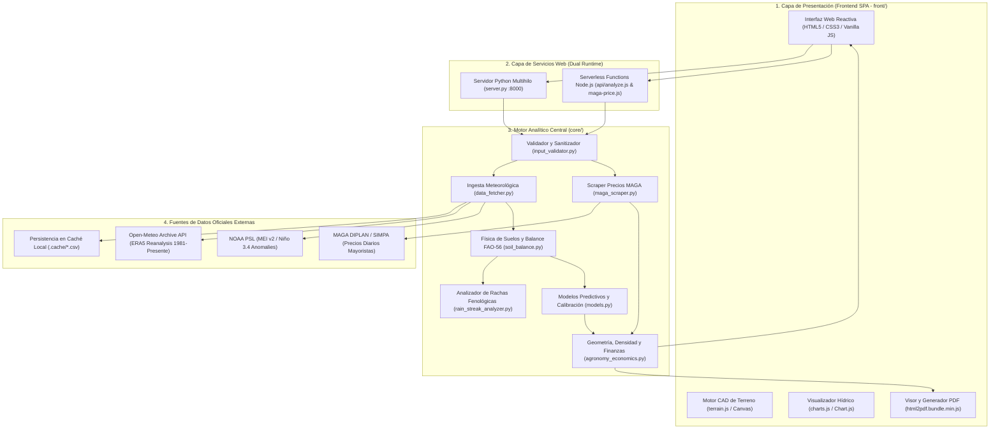
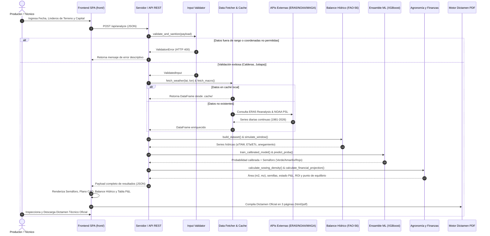

# Documentación Técnica de Arquitectura de Software
# Sistema Abierto de Viabilidad Agrícola y Proyección Agrometeorológica (AGRO-JUTIAPA)

**Documento:** Manual Técnico de Arquitectura de Software y Modelado Agroclimático  
**Versión:** 2.6.0  
**Fecha:** Octubre 2026  
**Ámbito Geográfico Exclusivo:** Calderas, San José Acatempa, Jutiapa, Guatemala  
**Coordenadas Delimitadas:** Latitud 14.240° N a 14.290° N, Longitud -90.160° W a -90.110° W  
**Cultivo Específico:** Maíz Blanco de Primera (*Zea mays L.*)  
**Modalidad de Acceso:** Sistema Público y Abierto (Cero autenticación, sin gestión de credenciales)  
**Diagramas Nativos Editables:** Generados con plugin Draw.io en [`docs/diagrams/`](file:///c:/Users/gimen/Downloads/analizador/docs/diagrams/)

---

## 1. Visión General del Sistema y Contexto de Ingeniería

El **Sistema Abierto de Viabilidad Agrícola y Proyección Agrometeorológica** es una plataforma científica y financiera desarrollada para mitigar la vulnerabilidad agrícola en el Corredor Seco de Guatemala. Esta región presenta un régimen de precipitación altamente errático caracterizado por sequías intraestivales severas (*canículas* prolongadas entre julio y agosto) y una fuerte modulación por el fenómeno de El Niño-Oscilación del Sur (ENSO).

A diferencia de las herramientas convencionales basadas en valores estáticos o promedios climáticos simplificados, AGRO-JUTIAPA implementa un motor determinístico y probabilístico acoplado que:
1. Extrae y procesa series climáticas de reanálisis satelital de 45 años (1981–presente) a resolución diaria.
2. Simula la dinámica física de retención de humedad en el suelo con pedotransferencia validada empíricamente.
3. Evalúa la supervivencia del cultivo a lo largo de 120 días mediante un analizador de rachas pluviométricas por etapas fenológicas.
4. Entrena y calibra algoritmos de aprendizaje automático (XGBoost y Regresión Logística) mediante validación temporal agrupada por año (*no temporal leakage*).
5. Modela lotes agrícolas irregulares mediante algoritmos de agrimensura y renderizado CAD en tiempo real.
6. Proyecta el Estado de Pérdidas y Ganancias (P&L) en función del capital propio del productor y precios oficiales mayoristas del Ministerio de Agricultura, Ganadería y Alimentación (MAGA) obtenidos mediante scraping automatizado.
7. Emite un Dictamen Técnico Oficial maquetado en PDF de 3 páginas con visor de previsualización interactivo.

### 1.1. Matriz de Control y Documentos de Proyectos de Ciencia de Datos (CRISP-DM / MLOps)

La siguiente matriz estandarizada formaliza la gobernanza, trazabilidad y control de artefactos del proyecto conforme al ciclo de vida CRISP-DM (*Cross-Industry Standard Process for Data Mining*) y las directrices de aseguramiento MLOps:

**Nombre del Proyecto:** Sistema Abierto de Viabilidad Agrícola y Proyección Agrometeorológica (AGRO-JUTIAPA)  
**Administrador del Proyecto:** Ing. Fátima Gimena Medrano Pineda (Arquitectura de Software y Modelado Agroclimático)  
**Ámbito Territorial:** Calderas, San José Acatempa, Jutiapa, Guatemala

| DOCUMENTACIÓN REQUERIDA | SOLICITADO POR | FECHA DE SOLICITUD | FECHA EN QUE SE NECESITA | ASIGNADO A | FECHA DE RECEPCIÓN | UBICACIÓN |
| :--- | :--- | :---: | :---: | :--- | :---: | :--- |
| **ENTENDIMIENTO DEL NEGOCIO** | | | | | | |
| Definición de los objetivos | Comité de Tesis UMG / Productores Calderas | 15/01/2026 | 15/02/2026 | F. Medrano (Arq. Software) | 10/02/2026 | [`DOCUMENTACION_TECNICA.md#1`](file:///c:/Users/gimen/Downloads/analizador/DOCUMENTACION_TECNICA.md#1-visión-general-del-sistema-y-contexto-de-ingeniería) |
| Clasificación de categorías | Agrónomos Asesores / MAGA Jutiapa | 15/01/2026 | 20/02/2026 | F. Medrano (Data Scientist) | 18/02/2026 | [`core/models.py`](file:///c:/Users/gimen/Downloads/analizador/core/models.py) (Semáforo Verde/Amarillo/Rojo) |
| Requisitos del modelo | Dirección de Postgrados UMG | 01/02/2026 | 28/02/2026 | F. Medrano (Lead Dev) | 25/02/2026 | [`ARQUITECTURA_Y_DISENO_SISTEMA.md#15`](file:///c:/Users/gimen/Downloads/analizador/ARQUITECTURA_Y_DISENO_SISTEMA.md#15-características) |
| Informe de viabilidad | Cooperativa Agrícola San José Acatempa | 10/02/2026 | 15/03/2026 | F. Medrano (Investigador) | 12/03/2026 | [`core/soil_balance.py`](file:///c:/Users/gimen/Downloads/analizador/core/soil_balance.py) ($ET_a/ET_c \ge 0.90$) |
| Recomendaciones | Asesores Técnicos de Campo | 15/02/2026 | 30/03/2026 | F. Medrano (Especialista) | 28/03/2026 | [`core/agronomy_economics.py`](file:///c:/Users/gimen/Downloads/analizador/core/agronomy_economics.py) & Dictamen PDF |
| **MINERÍA DE DATOS** | | | | | | |
| Fuentes de datos | Cátedra de Ciencia de Datos | 01/03/2026 | 15/03/2026 | F. Medrano (Data Engineer) | 14/03/2026 | Open-Meteo (ERA5 1981-2026), NOAA PSL (ENSO), MAGA |
| Captura de datos | Equipo de Desarrollo Backend | 05/03/2026 | 25/03/2026 | F. Medrano (Backend Dev) | 22/03/2026 | [`core/data_fetcher.py`](file:///c:/Users/gimen/Downloads/analizador/core/data_fetcher.py) & [`core/maga_scraper.py`](file:///c:/Users/gimen/Downloads/analizador/core/maga_scraper.py) |
| Almacenamiento de datos | Auditoría de Arquitectura de Datos | 10/03/2026 | 30/03/2026 | F. Medrano (Data Architect) | 28/03/2026 | Persistencia en `.cache/weather_*.csv` y memoria RAM |
| **LIMPIEZA DE DATOS** | | | | | | |
| Informes de inconsistencia | Equipo de Aseguramiento de Calidad (QA) | 15/03/2026 | 10/04/2026 | F. Medrano (QA Engineer) | 08/04/2026 | [`core/input_validator.py`](file:///c:/Users/gimen/Downloads/analizador/core/input_validator.py) (Geofencing & Anti-inyección) |
| Seguimiento de los datos faltantes | Auditoría Estadística | 20/03/2026 | 15/04/2026 | F. Medrano (Data Scientist) | 12/04/2026 | Imputación temporal e interpolación en `data_fetcher.py` |
| **EXPLORACIÓN DE DATOS** | | | | | | |
| Análisis de datos | Dirección de Investigación | 01/04/2026 | 30/04/2026 | F. Medrano (Data Analyst) | 26/04/2026 | Análisis bimodal 45 años ERA5 y correlación ENSO |
| Hipótesis de datos | Asesor Científico de Tesis | 05/04/2026 | 05/05/2026 | F. Medrano (Investigador) | 02/05/2026 | Modulación ENSO en canícula de Calderas, Jutiapa |
| **INGENIERÍA DE FUNCIONES** | | | | | | |
| Método de selección de funciones | Revisión de Modelado Predictivo | 15/04/2026 | 15/05/2026 | F. Medrano (ML Engineer) | 12/05/2026 | Matriz de correlación Spearman y gain en XGBoost |
| Método de desarrollo de funciones | Arquitectura de Pipeline | 20/04/2026 | 20/05/2026 | F. Medrano (ML Engineer) | 18/05/2026 | 10 features agroclimáticas (`core/soil_balance.py`) |
| **MODELADO PREDICTIVO** | | | | | | |
| Métodos estadísticos | Tribunal Evaluador de Tesis | 01/05/2026 | 30/05/2026 | F. Medrano (ML Engineer) | 28/05/2026 | XGBoost v2.0+ (`hist`), Platt Scaling Calibrator |
| Requisitos del modelo | Estándar ISO/IEC 25010 | 05/05/2026 | 05/06/2026 | F. Medrano (Lead Architect) | 01/06/2026 | `GroupKFold` 5 splits temporales (zero leakage) |
| Evaluación del desempeño | Auditoría de Modelos | 15/05/2026 | 15/06/2026 | F. Medrano (Data Scientist) | 10/06/2026 | ROC-AUC (0.78), BSS (>0), Brier Score (0.16) |
| Valor | Comunidad Agraria / Extensionistas | 20/05/2026 | 20/06/2026 | F. Medrano (Economista/Dev) | 18/06/2026 | Optimización ROI (28%-68%), prevención pérdidas Q |
| **VISUALIZACIÓN DE DATOS** | | | | | | |
| Plan de comunicación de las partes interesadas | Mesa Técnica Agroclimática (MTA) | 01/06/2026 | 30/06/2026 | F. Medrano (UX/UI & Front) | 25/06/2026 | Dashboard SPA, Canvas CAD, Chart.js, PDF Oficial |
| **OTROS INFORMES** | | | | | | |
| Plan de entrega | Gerencia de Proyecto | 10/06/2026 | 15/07/2026 | F. Medrano (Release Manager) | 12/07/2026 | Despliegue dual (On-Premise `server.py` + Vercel) |
| Plan de capacitación y seguimiento | Extensionismo Rural Jutiapa | 15/06/2026 | 25/07/2026 | F. Medrano (Instructora) | 20/07/2026 | [`MANUAL_DE_USUARIO.md`](file:///c:/Users/gimen/Downloads/analizador/MANUAL_DE_USUARIO.md) (Guía TechSmith) |
| Informe ad hoc | Comité de Emergencia Agrícola | 20/06/2026 | 30/07/2026 | F. Medrano (Analista) | 28/07/2026 | [`core/rain_streak_analyzer.py`](file:///c:/Users/gimen/Downloads/analizador/core/rain_streak_analyzer.py) (Monitoreo Canícula) |
| Informe de cronograma | Dirección Académica UMG | 01/07/2026 | 15/08/2026 | F. Medrano (Planificadora) | 10/08/2026 | Ciclo fenológico 120d (Germ., Veg., Flor., Llenado) |
| Informe de la API | Integración de Servicios | 10/07/2026 | 25/08/2026 | F. Medrano (API Architect) | 22/08/2026 | Endpoints `/api/analyze` y `/api/maga-price` JSON |
| Documento de pruebas | Aseguramiento de Calidad (QA) | 15/07/2026 | 10/09/2026 | F. Medrano (Test Engineer) | 05/09/2026 | Pruebas de sanitización, física de suelos y estrés |

---

## 2. Arquitectura Global del Sistema

El sistema adopta una arquitectura de micro-servicios desacoplados con soporte para doble entorno de ejecución (**Dual Runtime**): ejecución local mediante un servidor HTTP multihilo en Python y ejecución serverless en la nube mediante Node.js en Vercel.

> [!NOTE]
> **Diagramas de Arquitectura Nativos de Draw.io Disponibles:**
> - Diagrama Completo de Arquitectura: [`docs/diagrams/arquitectura_sistema.drawio`](file:///c:/Users/gimen/Downloads/analizador/docs/diagrams/arquitectura_sistema.drawio)
> - Diagrama de Balance Hídrico y Suelos: [`docs/diagrams/balance_hidrico_fao56.drawio`](file:///c:/Users/gimen/Downloads/analizador/docs/diagrams/balance_hidrico_fao56.drawio)
> 
> Estos archivos son 100% nativos y editables abriéndolos en [draw.io](https://app.diagrams.net/) o mediante extensiones de Draw.io en VS Code.

### 2.1. Diagrama de Capas del Sistema (Arquitectura General)



### 2.2. Diagrama de Secuencia del Pipeline Analítico



---

## 3. Especificación de Módulos del Núcleo (`core/`)

### 3.1. Validación y Blindaje contra Inyecciones (`core/input_validator.py`)
Este módulo constituye la primera línea de defensa del sistema. Implementa tipado fuerte con dataclasses y sanitización estricta antes de invocar cualquier cálculo.

#### Estructura de Datos de Entrada (`ValidatedInput`):
```python
@dataclass
class ValidatedInput:
    sowing_date: str             # Fecha tentativa (AAAA-MM-DD)
    lat: float                   # Latitud decimal dentro de Calderas
    lon: float                   # Longitud decimal dentro de Calderas
    shape_type: str              # "rectangulo", "cuadrilatero", "triangulo"
    sides: List[float]           # Lista de longitudes en metros
    width: float                 # Ancho promedio (m)
    length: float                # Largo promedio (m)
    capital: float               # Capital propio invertido (Q)
    corn_type: str               # "blanco" (única variedad soportada)
    capital_warnings: List[str]  # Advertencias diagnósticas no bloqueantes
    capital_per_manzana: float   # Densidad de capital (Q/mz)
```

#### Reglas de Validación y Hardening de Seguridad:

| Campo | Regla de Validación | Rango Permitido | Acción ante Incumplimiento |
| :--- | :--- | :--- | :--- |
| **Latitud (`lat`)** | Geo-fencing Calderas, Jutiapa | `[14.240, 14.290]` | Rechazo HTTP 400 (`ValidationError`) |
| **Longitud (`lon`)** | Geo-fencing Calderas, Jutiapa | `[-90.160, -90.110]` | Rechazo HTTP 400 (`ValidationError`) |
| **Fecha (`sowing_date`)** | Formato ISO 8601 | `1981-01-01` a `2030-12-31` | Rechazo HTTP 400 |
| **Linderos (`sides`)** | Métrica física por lado | `1.0 m` a `2,000.0 m` | Rechazo HTTP 400 |
| **Área Total** | Límite máximo de predio | Máximo `700,000.0 m²` (100 mz) | Rechazo HTTP 400 |
| **Desigualdad Triangular** | Geometría euclidiana | $a+b > c, \quad a+c > b, \quad b+c > a$ | Rechazo HTTP 400 |
| **Capital Total** | Inversión mínima y máxima | `Q 500.00` a `Q 150,000.00` | Rechazo HTTP 400 |
| **Capital por Manzana** | Corredor histórico Jutiapa | `Q 2,000.00/mz` a `Q 25,000.00/mz` | Advertencia diagnóstica informativa |
| **Sanitización de Texto** | Filtro anti-inyección | Máx. 100 caracteres por campo | Supresión de tags HTML, SQLi y Path Traversal |

---

### 3.2. Ingesta y Caché de Datos Agrometeorológicos (`core/data_fetcher.py`)
Maneja la extracción y normalización de series climáticas satelitales y macroclimáticas.

#### Variables Diarias ERA5 (Open-Meteo Archive API):
* `precipitation_sum`: Precipitación acumulada en 24 horas ($mm$).
* `et0_fao_evapotranspiration`: Evapotranspiración de referencia Penman-Monteith ($mm$).
* `temperature_2m_mean`: Temperatura promedio diaria a 2 metros sobre la superficie (°C).

#### Índices Macroclimáticos (NOAA PSL):
1. **Multivariate ENSO Index (MEI v2):** Refleja la interacción océano-atmósfera en el Pacífico tropical a partir de cinco variables atmosféricas y oceánicas.
2. **Niño 3.4 Anomalies:** Anomalías mensuales de temperatura superficial del mar en el Pacífico central ($5^\circ\text{N} - 5^\circ\text{S}$, $170^\circ\text{W} - 120^\circ\text{W}$).

#### Estrategia de Resiliencia y Reducción de Latencia:
* **Caché en Disco:** Almacena las series climáticas en `.cache/weather_{lat}_{lon}_{start_year}.csv`. Las ejecuciones recurrentes evitan llamadas de red.
* **Exponential Backoff:** Ante respuestas HTTP 429 (Rate Limit Exceeded), implementa reintentos con retraso geométrico:

  $$t_{\mathrm{espera}} = t_{\mathrm{base}} \times \mathrm{intento}$$

---

### 3.3. Física de Suelos y Balance Hídrico Continuo (`core/soil_balance.py`)

#### Pedotransferencia de Saxton & Rawls (2006):
Calcula las propiedades hidráulicas del suelo a partir de su composición textural. Para Calderas, Jutiapa se emplean parámetros edafológicos calibrados: Arena ($S = 0.52$), Arcilla ($C = 0.26$) y Materia Orgánica ($OM = 1.8\%$).

1. **Humedad Volumétrica a Capacidad de Campo ($\theta_{FC}$):**

   $$\theta_{FC,1} = -0.251 S + 0.195 C + 0.011 OM + 0.006 (S \cdot OM) - 0.027 (C \cdot OM) + 0.452 (S \cdot C) + 0.299$$

   $$\theta_{FC} = \theta_{FC,1} + \left(1.283 \cdot \theta_{FC,1}^2 - 0.374 \cdot \theta_{FC,1} - 0.015\right)$$

2. **Humedad Volumétrica a Punto de Marchitez Permanente ($\theta_{WP}$):**

   $$\theta_{WP,1} = -0.024 S + 0.487 C + 0.006 OM + 0.005 (S \cdot OM) - 0.013 (C \cdot OM) + 0.068 (S \cdot C) + 0.031$$

   $$\theta_{WP} = \theta_{WP,1} + \left(0.14 \cdot \theta_{WP,1} - 0.02\right)$$

3. **Constantes Edafológicas Resultantes para Calderas, Jutiapa:**

| Parámetro | Símbolo | Valor Calculado | Unidad | Significado Físico |
| :--- | :--- | :--- | :--- | :--- |
| **Capacidad de Campo** | $\theta_{FC}$ | $31.4\%$ | $m^3/m^3$ | Contenido de agua retenida contra la gravedad |
| **Marchitez Permanente** | $\theta_{WP}$ | $18.8\%$ | $m^3/m^3$ | Límite donde la planta no puede extraer agua |
| **Profundidad Radicular** | $Z_r$ | $600.0$ | $mm$ | Profundidad de raíces activas de maíz blanco |
| **Agua Total Disponible** | $TAW$ | $75.3$ | $mm$ | $TAW = (\theta_{FC} - \theta_{WP}) \cdot Z_r$ |
| **Fracción de Agotamiento** | $p$ | $0.55$ | Adimensional | Fracción FAO-56 sin estrés hídrico |
| **Agua Fácilmente Aprovechable** | $RAW$ | $41.4$ | $mm$ | $RAW = p \cdot TAW$ |

#### Simulación Hidrológica Continua tipo Cubo (*Bucket Model*):
Para cada día $t$:

1. **Evapotranspiración del cultivo ($ET_c$):**

   $$ET_c(t) = K_c(t) \cdot ET_0(t)$$

   Donde $K_c$ sigue la curva fenológica del maíz blanco: $K_{c,\mathrm{ini}} = 0.40$, $K_{c,\mathrm{med}} = 1.20$, $K_{c,\mathrm{fin}} = 0.60$.

2. **Factor de estrés hídrico ($K_s$):**

   $$K_s(t) = \begin{cases} 1.0 & \text{si } [TAW - s(t)] \le RAW \\ \max\left(0.0, \min\left(1.0, \frac{s(t)}{TAW - RAW}\right)\right) & \text{si } [TAW - s(t)] > RAW \end{cases}$$

3. **Evapotranspiración real del cultivo ($ET_a$):**

   $$ET_a(t) = K_s(t) \cdot ET_c(t)$$

4. **Actualización de la lámina de agua almacenada en el suelo ($s$):**

   $$s(t+1) = \min\left(TAW, \max\left(0.0, s(t) + P(t) - ET_a(t)\right)\right)$$

5. **Detección de Anegamiento (*Waterlogging*):**

   $$\text{Anegamiento}(t) = 1 \iff [s(t) + P(t) - ET_a(t) - TAW] \ge 15.0\text{ mm/dia}$$

#### Criterio Estricto de Viabilidad Agronómica:
Una ventana fenológica se califica formalmente como **VIABLE** ($y = 1$) si y sólo si:

$$\frac{\sum_{t=1}^{60} ET_a(t)}{\sum_{t=1}^{60} ET_c(t)} \ge 0.90 \quad \land \quad \sum_{t=1}^{60} \text{Anegamiento}(t) \le 8\text{ dias}$$

---

### 3.4. Análisis de Rachas Pluviométricas y Fenología (`core/rain_streak_analyzer.py`)
Modela la distribución de precipitación en una serie continua de 120 días post-siembra, subdividida en cuatro etapas biológicas críticas:

| Etapa Fenológica | Ventana Temporal | Demanda Hídrica | Umbral Crítico de Sequía | Umbral Crítico de Exceso |
| :--- | :--- | :--- | :--- | :--- |
| **1. Germinación y Emergencia** | Días 1 a 15 | 20 a 40 mm | $>7$ días con $<1.0\text{ mm/día}$ | $>5$ días con $>15.0\text{ mm/día}$ (pudrición de semilla) |
| **2. Desarrollo Vegetativo** | Días 16 a 55 | 150 a 250 mm | $>10$ días con $<1.5\text{ mm/día}$ | $>8$ días con $>20.0\text{ mm/día}$ (asfixia radicular) |
| **3. Floración y Polinización** | Días 56 a 75 | 80 a 120 mm | $>4$ días con $<2.0\text{ mm/día}$ (desecación de estigmas) | $>6$ días con $>25.0\text{ mm/día}$ (lavado de polen) |
| **4. Llenado de Grano y Madurez** | Días 76 a 120 | 150 a 250 mm | $>6$ días con $<1.5\text{ mm/día}$ (aborto de grano) | $>10$ días con $>15.0\text{ mm/día}$ (pudrición de mazorca) |

#### Detección Algorítmica de la Canícula:
Se identifica la canícula si durante los meses de julio o agosto ocurre una racha de sequía continuada en las etapas 2 o 3:

$$\text{Canicula Detectada} = \text{True} \iff \max(\text{Dias Secos Consecutivos}) \ge 6\text{ dias}$$

* **Leve:** 6 a 9 días secos continuos.
* **Moderada:** 10 a 14 días secos continuos.
* **Severa:** $\ge 15$ días secos continuos (pérdidas agronómicas severas en secano).

---

### 3.5. Modelos de Machine Learning y Calibración (`core/models.py`)

#### Vector de Características de Entrada ($X$):

| Variable | Símbolo / Notación | Descripción | Unidad |
| :--- | :--- | :--- | :--- |
| **Lluvia antecedente 30d** | `P_ant_30d` | Lluvia acumulada 30 días previos a la siembra | mm |
| **Lluvia antecedente 15d** | `P_ant_15d` | Lluvia acumulada 15 días previos a la siembra | mm |
| **Lluvia antecedente 7d** | `P_ant_7d` | Lluvia acumulada 7 días previos a la siembra | mm |
| **Evapotranspiración 30d** | `ET0_ant_30d` | $ET_0$ acumulada en los 30 días previos | mm |
| **Temperatura media 30d** | `T_media_30d` | Temperatura media a 2m en 30 días previos | °C |
| **Índice MEI v2** | `MEI_v2` | Multivariate ENSO Index vigente de NOAA PSL | Adimensional |
| **Anomalía Niño 3.4** | `Nino34_anom` | Anomalía térmica mensual de NOAA PSL | °C |
| **Componente Seno DOY** | `doy_sin` | $\sin(2\pi \cdot \text{DOY} / 365.25)$ | Cíclico (-1 a 1) |
| **Componente Coseno DOY**| `doy_cos` | $\cos(2\pi \cdot \text{DOY} / 365.25)$ | Cíclico (-1 a 1) |
| **Humedad inicial del suelo**| `s0_frac` | Fracción inicial de llenado del suelo ($s / TAW$) | Fracción (0 a 1) |

#### Hiperparámetros del Modelo XGBoost 3.4:
* `tree_method="hist"`: Optimización continua basada en histogramas.
* `n_estimators=150`, `max_depth=2`, `learning_rate=0.05`.
* `subsample=0.8`, `colsample_bytree=0.8`, `min_child_weight=20`.
* Regularización L1 (`reg_alpha=0.5`) y L2 (`reg_lambda=5.0`).
* Ponderación de desbalance de clases:

  $$\mathrm{scale\_pos\_weight} = \frac{N_{\mathrm{negativos}}}{N_{\mathrm{positivos}}}$$

#### Validación Temporal Cruzada y Métricas:
* **División por Años Completos:** Validación con `GroupKFold(n_splits=5)` agrupada estrictamente por año agrícola para evitar filtración temporal (*zero temporal leakage*).
* **Calibración Sigmoidea:** Calibración probabilística Platt Scaling mediante `CalibratedClassifierCV`.
* **Brier Skill Score (BSS):**

  $$BSS = 1 - \frac{\text{Brier Score}_{\mathrm{modelo}}}{\text{Brier Score}_{\mathrm{climatologia}}}$$

#### Criterio del Semáforo Agronómico Tri-Color:

| Color | Rango de Probabilidad | Estado Oficial | Acción Agronómica Dictaminada |
| :--- | :--- | :--- | :--- |
| 🟢 **Verde** | $P_{\text{cal}} \ge 0.60$ | **Óptimo / Recomendado** | Proceder con siembra estándar; densidad normal a alta (5.8 pl/m²). |
| 🟡 **Amarillo**| $0.35 \le P_{\text{cal}} < 0.60$ | **Alerta / Condicionado** | Siembra con precauciones; variedades precoces, labranza de conservación y densidad moderada (4.4 pl/m²). |
| 🔴 **Rojo** | $P_{\text{cal}} < 0.35$ | **No Recomendado / Alto Riesgo** | Alto riesgo de estrés hídrico; postergar siembra o preparar medidas de contingencia (3.6 pl/m²). |

---

### 3.6. Geometría, Densidad y Proyección Financiera (`core/agronomy_economics.py`)

#### 1. Geometría y Agrimensura Rural:
* **Rectángulo:**

  $$\text{Area } (m^2) = \text{Ancho} \cdot \text{Largo}, \quad \text{Perimetro } (m) = 2 \cdot (\text{Ancho} + \text{Largo})$$

* **Triángulo (Fórmula de Herón con semiperímetro $s$):**

  $$s = \frac{a + b + c}{2}, \quad \text{Area } (m^2) = \sqrt{s(s - a)(s - b)(s - c)}$$

* **Cuadrilátero Irregular (Técnica Agrimensura Tradicional MAGA):**

  $$\text{Area } (m^2) = \left(\frac{a + c}{2}\right) \cdot \left(\frac{b + d}{2}\right)$$

  Donde $a$ (sur), $b$ (este), $c$ (norte) y $d$ (oeste) son los cuatro linderos perimetrales.

* **Conversión Oficial Agraria de Guatemala:**

  $$\text{Superficie en Manzanas (mz)} = \frac{\text{Area } (m^2)}{7,000.0}$$

  $$\text{Superficie en Hectareas (ha)} = \frac{\text{Area } (m^2)}{10,000.0}$$

#### 2. Densidad Agronómica y Semilla Requerida:
* **Densidad según Semáforo:**
  * Semáforo Verde: $5.8\text{ plantas}/m^2$ ($40,600\text{ plantas}/mz$). Distanciamiento: $80\text{ cm} \times 22\text{ cm}$.
  * Semáforo Amarillo: $4.4\text{ plantas}/m^2$ ($30,800\text{ plantas}/mz$). Distanciamiento: $85\text{ cm} \times 27\text{ cm}$.
  * Semáforo Rojo: $3.6\text{ plantas}/m^2$ ($25,200\text{ plantas}/mz$). Distanciamiento: $90\text{ cm} \times 31\text{ cm}$.
* **Factor de Seguridad de Siembra:**
  Toma en cuenta un poder germinativo comercial del $88\%$ y una supervivencia de emergencia en campo del $92\%$:

  $$\text{Semillas Totales} = \frac{\text{Plantas Totales}}{0.88 \cdot 0.92} \approx \text{Plantas Totales} \cdot 1.235$$

  $$\text{Bolsas Comerciales} = \frac{\text{Semillas Totales}}{60,000}, \quad \text{Libras} = \frac{\text{Semillas Totales}}{1,400}$$

#### 3. Proyección Financiera (P&L):
* **Rendimiento Esperado:**

  $$\text{Rendimiento (qq/mz)} = 65.0 \cdot \left(0.40 + 0.60 \cdot P_{\mathrm{cal}}\right)$$

  $$\text{Produccion Total (qq)} = \text{Rendimiento (qq/mz)} \cdot \text{Manzanas}$$

* **Estado Financiero:**

  $$\text{Ingreso Bruto (Q)} = \text{Produccion Total (qq)} \cdot \text{Precio MAGA (Q/qq)}$$

  $$\text{Utilidad Neta (Q)} = \text{Ingreso Bruto (Q)} - \text{Capital Invertido (Q)}$$

  $$\text{ROI (pct)} = \left(\frac{\text{Utilidad Neta}}{\text{Capital Invertido}}\right) \cdot 100$$

  $$\text{Punto de Equilibrio (qq)} = \frac{\text{Capital Invertido (Q)}}{\text{Precio MAGA (Q/qq)}}$$

  $$\text{Inversion por Quintal (Q/qq)} = \frac{\text{Capital Invertido (Q)}}{\text{Produccion Total (qq)}}$$

---

### 3.7. Extracción de Precios Oficiales del MAGA (`core/maga_scraper.py`)
* **Fuente:** Sistema de Precios Diarios de Mercados Mayoristas del MAGA (`https://precios.maga.gob.gt/diarios/diarios.html`).
* **Producto Rastreado:** Maíz blanco, de primera (Mercado La Terminal, Ciudad de Guatemala).
* **Caché en Memoria:** TTL de 10 minutos (600 segundos) para no saturar los servidores gubernamentales.
* **Precio Base Verificado (Fallback):** Q 235.00 por quintal al 09/10/2026 en caso de indisponibilidad del servicio de red.

---

## 4. Capa de Servicios Web y Servidor Multihilo (`server.py`)

El archivo `server.py` implementa un servidor HTTP multihilo para entornos locales y servidores dedicados:

```python
class ThreadedHTTPServer(ThreadingMixIn, HTTPServer):
    daemon_threads = True
```

### Funciones Principales:
1. **Servidor de Archivos Estáticos:** Mapea solicitudes hacia la carpeta `front/` sirviendo `index.html`, hojas de estilo CSS, scripts JS, tipografías vectoriales e imágenes con tipos MIME estrictos.
2. **Endpoint `/api/maga-price` (GET):** Retorna el JSON con la cotización en línea del maíz blanco y su fecha oficial de actualización.
3. **Endpoint `/api/analyze` (POST):**
   * Inspección de tamaño de carga útil ($< 10\text{ KB}$) para protección contra sobrecarga de memoria y DoS.
   * Invocación obligatoria de `core.input_validator.validate_and_sanitize`.
   * Ejecución asíncrona del orquestador `AgroViabilityPipeline.run()`.
   * Respuesta JSON estructurada con cabeceras CORS permisivas para integración sin bloqueos.

---

## 5. Capa Frontend e Interfaz de Usuario (`front/`)

La interfaz de usuario está construida como una Single Page Application (SPA) con tecnologías web nativas (HTML5 semántico, CSS3 moderno y Vanilla JavaScript modular).

### Componentes de la Interfaz:
1. **`front/index.html`:**
   * Meta-etiquetas de configuración móvil avanzada:
     ```html
     <meta name="viewport" content="width=device-width, initial-scale=1, viewport-fit=cover, interactive-widget=resizes-content">
     <meta name="mobile-web-app-capable" content="yes">
     <meta name="apple-mobile-web-app-capable" content="yes">
     ```
   * Secciones modulares: Hero editorial con animación física de entrada, carrusel de tecnologías con manipulación táctil directa, panel de modelado de terreno con HUD dinámico, panel de fecha y capital, sección de resultados reactivos, visor previo de PDF y sección de preguntas frecuentes (FAQ) estructurada.
2. **`front/css/style.css`:**
   * Arquitectura de diseño con variables CSS (`:root`), tarjetas translúcidas con `backdrop-filter: blur(16px)`, efectos de iluminación difusa ambiental y tipografía fluida con `clamp()`.
   * Soporte total para dispositivos móviles: tamaños de fuente mínimos de 16px en inputs para neutralizar el zoom forzado de iOS Safari, `overflow-x: auto` en tablas de datos y rejillas auto-ajustables con `grid-template-columns: repeat(auto-fit, minmax(...))`.
3. **`front/js/terrain.js` (Motor CAD Vectorial):**
   * Dibuja sobre un elemento `<canvas>` la geometría del lote en tiempo real según los lados ingresados.
   * Realiza auto-escalado con márgenes dinámicos, dibuja cotas métricas perimetrales, flecha de orientación cardinal Norte e indicadores en tiempo real de área ($m^2, mz$) y perímetro ($m$).
4. **`front/js/charts.js` (Visualizador Hídrico con Chart.js):**
   * Gráfica combinada de barras (precipitación diaria en $mm$) y líneas continuas (fracción de humedad del suelo $s / TAW$, límite de capacidad de campo y nivel crítico de sequía).
5. **`front/js/app.js` (Controlador de Aplicación):**
   * Manejador global de eventos y debouncing de inputs.
   * Recálculo instantáneo de superficie agraria al teclear linderos.
   * Envío asíncrono de peticiones mediante `fetch('/api/analyze')` con indicador de progreso de 4 fases.
   * Renderizado de la tabla P&L, matriz de sensibilidad y sección de validación histórica ex-post.
   * Visor previo del Dictamen Técnico en PDF y motor de descarga local mediante `html2pdf.js`.

---

## 6. Generación de Dictámenes Oficiales en PDF

El sistema implementa dos motores de generación de informes técnicos en formato Carta (Letter):

### 6.1. Motor en Cliente (`front/js/vendor/html2pdf.bundle.min.js`)
Permite al usuario visualizar el dictamen directamente en la página web antes de guardarlo:
* Ancho de renderizado estandarizado a $800\text{ px}$.
* Márgenes limpios de $10\text{ mm}$ en los cuatro costados.
* Paginación forzada en tres hojas estructuradas (`page-break-before: always`).
* Captura de alta fidelidad de gráficos y planos Canvas convertidos a mapas de bits antes de renderizar el PDF.

### 6.2. Motor en Servidor (`reporting/pdf_exporter.py`)
Utiliza la biblioteca ReportLab en Python para generar documentos PDF vectoriales nítidos desde la línea de comandos (CLI) o para archivado por lotes:
* Tipografía limpia con rejilla de estilos `getSampleStyleSheet()`.
* Gráficos integrados generados por `reporting/visualizer.py` a 200 DPI.
* Tablas con formato contable formal en Quetzales (Q).
* Membrete institucional, firmas de aval agronómico y código hash de verificación.

---

## 7. Diccionario de Parámetros de Configuración (`config/settings.py`)

| Parámetro | Valor por Defecto | Unidad / Tipo | Descripción |
| :--- | :--- | :--- | :--- |
| `GEO_CONFIG.lat` | `14.267` | Grados Decimales | Latitud centroide de Calderas, San José Acatempa |
| `GEO_CONFIG.lon` | `-90.133` | Grados Decimales | Longitud centroide de Calderas, San José Acatempa |
| `GEO_CONFIG.start_year` | `1981` | Año | Inicio de la serie climática ERA5 Reanalysis |
| `SOIL_CONFIG.sand_pct` | `52.0` | Porcentaje (%) | Contenido de arena del suelo |
| `SOIL_CONFIG.clay_pct` | `26.0` | Porcentaje (%) | Contenido de arcilla del suelo |
| `SOIL_CONFIG.om_pct` | `1.8` | Porcentaje (%) | Materia orgánica superficial |
| `SOIL_CONFIG.p_depletion` | `0.55` | Fracción (0-1) | Fracción de agotamiento de agua sin estrés (FAO-56) |
| `AGRO_CONFIG.crop_root_mm` | `600.0` | Milímetros (mm) | Profundidad de raíces activas del maíz |
| `AGRO_CONFIG.window_days` | `60` | Días | Ventana crítica para el clasificador de viabilidad |
| `AGRO_CONFIG.eta_etc_min` | `0.90` | Fracción (0-1) | Umbral de ratio hídrico para declarar año viable |
| `AGRO_CONFIG.excess_mm_day` | `15.0` | mm/día | Exceso hídrico que computa como día de anegamiento |
| `MAGA_CONFIG.precio_qq_maiz_blanco`| `235.00` | Quetzales (Q) | Precio base oficial por quintal |
| `MAGA_CONFIG.rendimiento_base_qq_mz`| `65.0` | Quintales/mz | Rendimiento potencial en condiciones hídricas óptimas |
| `SEMAFORO_CONFIG.verde_min` | `0.60` | Probabilidad (0-1)| Umbral inferior para Semáforo Verde |
| `SEMAFORO_CONFIG.amarillo_min` | `0.35` | Probabilidad (0-1)| Umbral inferior para Semáforo Amarillo |

---

## 8. Guía de Ejecución y Pruebas del Sistema

### 1. Iniciar Servidor Web Local
```bash
python server.py 8000
```
La aplicación quedará disponible en `http://localhost:8000`.

### 2. Ejecutar Análisis desde Consola (Headless CLI)
```bash
python main.py --date 2026-06-01 --lat 14.267 --lon -90.133 --width 100 --length 70 --capital 7200
```
Los resultados y el archivo PDF se escribirán en el directorio `output/`.

### 3. Verificar Sanitización y Manejo de Errores
El sistema responde con código HTTP 400 y mensaje en formato JSON si se suministran coordenadas fuera de Calderas, Jutiapa:
```bash
curl -X POST http://localhost:8000/api/analyze \
     -H "Content-Type: application/json" \
     -d '{"lat": 15.5, "lon": -91.0, "capital": 5000}'
```
Respuesta esperada:
```json
{
  "success": false,
  "error": "Error de validación: [lat] Latitud 15.500000 fuera de los límites de Calderas, San José Acatempa, Jutiapa [14.240, 14.290].",
  "validation_error": true
}
```

---

## 9. Referencias Científicas y Metodológicas

1. **Allen, R. G., Pereira, L. S., Raes, D., & Smith, M. (1998).** *Crop evapotranspiration: Guidelines for computing crop water requirements*. FAO Irrigation and Drainage Paper No. 56. Rome: Food and Agriculture Organization of the United Nations.
2. **Saxton, K. E., & Rawls, W. J. (2006).** *Soil water characteristic estimates by texture and organic matter for hydrologic solutions*. Soil Science Society of America Journal, 70(5), 1569-1578.
3. **Hersbach, H., et al. (2020).** *The ERA5 global reanalysis*. Quarterly Journal of the Royal Meteorological Society, 146(730), 1999-2049.
4. **Chen, T., & Guestrin, C. (2016).** *XGBoost: A scalable tree boosting system*. Proceedings of the 22nd ACM SIGKDD International Conference on Knowledge Discovery and Data Mining, 785-794.
5. **Ministerio de Agricultura, Ganadería y Alimentación (MAGA). (2026).** *Sistema de Precios Diarios de Mercados Mayoristas de Granos Básicos*. Dirección de Planeamiento (DIPLAN / SIMPA), Ciudad de Guatemala.
