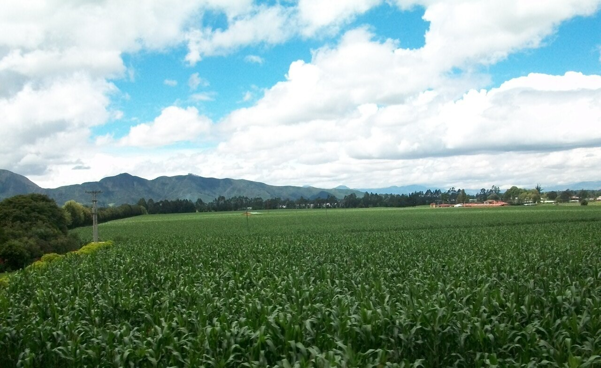
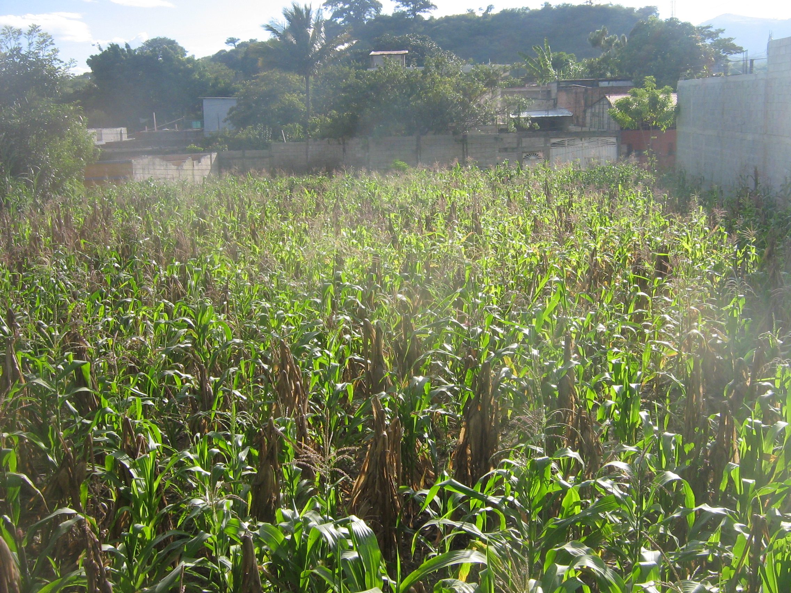
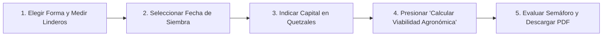
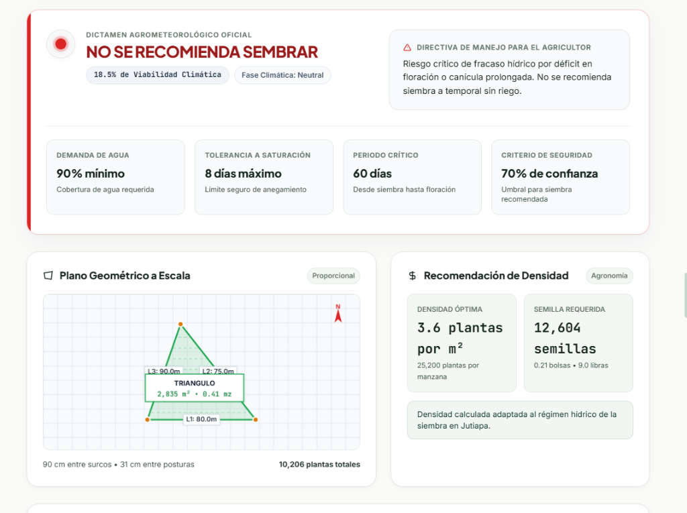
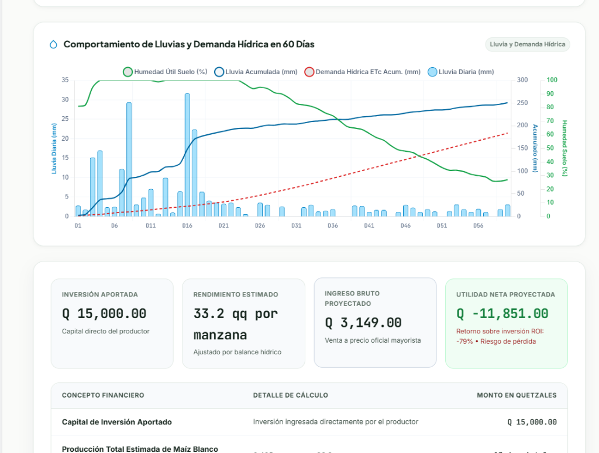
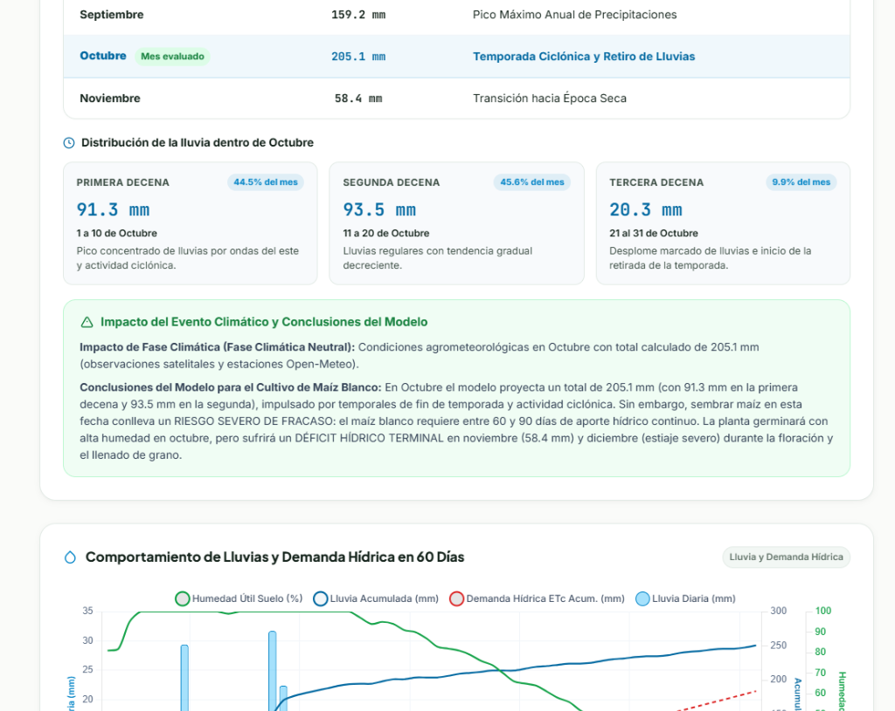
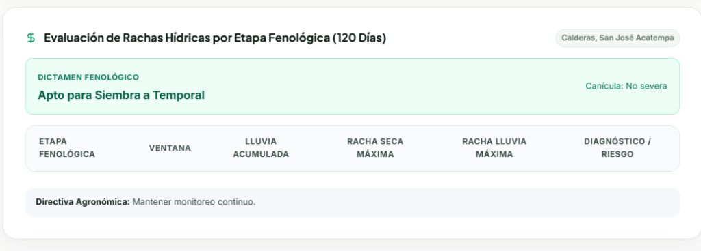
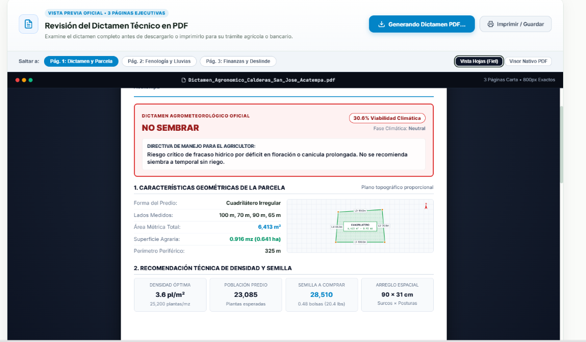
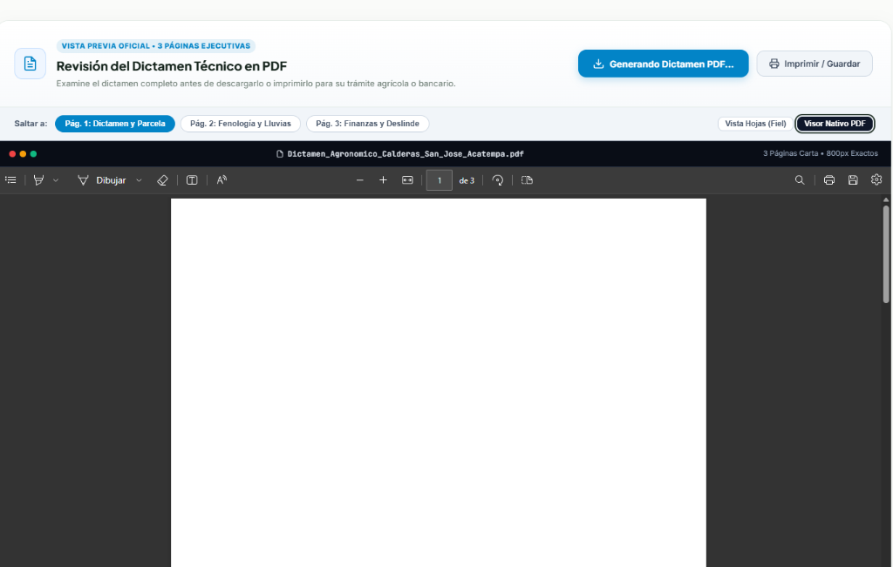

# Manual de Usuario: Guía Completa de Uso y Buenas Prácticas
## Sistema Abierto de Viabilidad Agrícola y Proyección Agrometeorológica (AGRO-JUTIAPA)

**Documento:** Manual Oficial de Operación y Procedimientos de Usuario  
**Versión de la Aplicación:** 2.6.0  
**Fecha de Edición:** Octubre 2026  
**Repositorio Oficial de Código Fuente:** [https://github.com/GimenaMP/analizador.git](https://github.com/GimenaMP/analizador)  
**Documento Técnico de Arquitectura:** [`DOCUMENTACION_TECNICA.md`](file:///c:/Users/gimen/Downloads/analizador/DOCUMENTACION_TECNICA.md) | PDF: [`docs/DOCUMENTACION_TECNICA.pdf`](file:///c:/Users/gimen/Downloads/analizador/docs/DOCUMENTACION_TECNICA.pdf)  
**Diagramas Nativos Editables:** Colección Draw.io en [`docs/diagrams/`](file:///c:/Users/gimen/Downloads/analizador/docs/diagrams/)  
**Audiencia Objetivo:** Agricultores de pequeña escala, productores de granos básicos, técnicos de extensión rural del MAGA, cooperativas agrícolas y analistas de crédito rural  
**Región de Operación:** Aldea Calderas, San José Acatempa, Departamento de Jutiapa, Guatemala  
**Tipo de Cultivo:** Maíz Blanco de Primera (*Zea mays L.*)  
**Metodología de Documentación:** Estándar de Comunicación Técnica y Manuales de Usuario (TechSmith Guidelines)

---

## Índice General

1. [Introducción y Objetivos de la Plataforma](#1-introducción-y-objetivos-de-la-plataforma)
2. [Requisitos Previos y Preparación de Datos](#2-requisitos-previos-y-preparación-de-datos)
3. [Recorrido Visual por la Pantalla Principal](#3-recorrido-visual-por-la-pantalla-principal)
4. [Guía Paso a Paso: Configuración y Análisis](#4-guía-paso-a-paso-configuración-y-análisis)
   * [Paso 1: Modelado Geométrico de la Parcela (Linderos)](#paso-1-modelado-geométrico-de-la-parcela-linderos)
   * [Paso 2: Selección de la Fecha Tentativa de Siembra](#paso-2-selección-de-la-fecha-tentativa-de-siembra)
   * [Paso 3: Ingreso del Capital Propio de Inversión](#paso-3-ingreso-del-capital-propio-de-inversión)
   * [Paso 4: Activación del Motor Agrometeorológico](#paso-4-activación-del-motor-agrometeorológico)
5. [Interpretación de Resultados para la Toma de Decisiones](#5-interpretación-de-resultados-para-la-toma-de-decisiones)
   * [5.1. Semáforo Agroclimático de Viabilidad](#51-semáforo-agroclimático-de-viabilidad)
   * [5.2. Plano a Escala y Superficie Neta](#52-plano-a-escala-y-superficie-neta)
   * [5.3. Densidad de Población y Semilla Comercial Requerida](#53-densidad-de-población-y-semilla-comercial-requerida)
   * [5.4. Gráfica de Balance Hídrico y Humedad en 60 Días](#54-gráfica-de-balance-hídrico-y-humedad-en-60-días)
   * [5.5. Análisis Pluviométrico por Decenas y Conclusiones](#55-análisis-pluviométrico-por-decenas-y-conclusiones)
   * [5.6. Estado de Pérdidas y Ganancias (P&L) y Rentabilidad](#56-estado-de-pérdidas-y-ganancias-pl-y-rentabilidad)
   * [5.7. Matriz de Sensibilidad de Escenarios](#57-matriz-de-sensibilidad-de-escenarios)
   * [5.8. Evaluación de Rachas Fenológicas a 120 Días y Canícula](#58-evaluación-de-rachas-fenológicas-a-120-días-y-canícula)
6. [Estación de Trabajo del Dictamen Técnico en PDF](#6-estación-de-trabajo-del-dictamen-técnico-en-pdf)
7. [Buenas Prácticas para Garantizar Resultados Confiables](#7-buenas-prácticas-para-garantizar-resultados-confiables)
8. [Resolución de Problemas Frecuentes (FAQ / Troubleshooting)](#8-resolución-de-problemas-frecuentes-faq--troubleshooting)
9. [Glosario de Términos Agronómicos y Financieros](#9-glosario-de-términos-agronómicos-y-financieros)

---

## 1. Introducción y Objetivos de la Plataforma

Bienvenido al **Sistema Abierto de Viabilidad Agrícola AGRO-JUTIAPA**. Esta plataforma informática fue diseñada para resolver el problema más crítico que enfrentan los agricultores de San José Acatempa: **la incertidumbre climática y el riesgo de perder la inversión en semillas, fertilizantes y jornales debido a sequías imprevistas o canículas prolongadas**.



### ¿Qué hace la aplicación por usted?
* **Evalúa el agua disponible:** Cruza 45 años de observaciones satelitales (ERA5) con las características del suelo de Calderas para saber si el maíz tendrá suficiente humedad para espigar y llenar grano.
* **Calcula el tamaño real del lote:** Transforma las medidas de sus linderos (ya sea un lote cuadrado, triangular o irregular de 4 lados diferentes) a metros cuadrados, manzanas y hectáreas exactas.
* **Le dice cuánta semilla comprar:** Le indica con precisión cuántas bolsas comerciales o libras de semilla necesita para no gastar de más.
* **Proyecta sus ganancias en Quetzales:** Utiliza el precio oficial del maíz blanco en el mercado mayorista del MAGA y el dinero que usted aportará para calcular la ganancia neta, el punto de equilibrio y el retorno de inversión.
* **Genera un Dictamen Técnico Oficial en PDF:** Le entrega un documento formal de 3 páginas firmado que puede imprimir o presentar ante cooperativas y bancos.

> [!NOTE]
> **Acceso 100% Libre y Seguro:** La plataforma no requiere registrarse, no solicita contraseñas ni almacena su nombre o datos bancarios. Su uso es gratuito y confidencial.

---

## 2. Requisitos Previos y Preparación de Datos

Para obtener los mejores resultados, tenga a mano la siguiente información básica de su parcela antes de realizar la consulta:

1. **Forma aproximada y medidas del terreno en metros:**
   * Si es rectangular: el ancho y el largo.
   * Si es triangular: la medida de los 3 linderos.
   * Si es de 4 lados desiguales: la medida de los costados Norte, Este, Sur y Oeste.
2. **Fecha tentativa en que planea sembrar:**
   * Se recomienda explorar fechas de la **Época de Primera** (Mayo a Julio) o de la **Época de Postrera** (Agosto a Octubre).
3. **Monto de dinero propio que invertirá en el ciclo:**
   * Por ejemplo: Q 5,000.00, Q 7,200.00 o Q 10,000.00 (el costo total contemplado para semillas, preparación de tierra, abono y corte).
4. **Dispositivo:** Teléfono inteligente, tableta o computadora con navegador web moderno (Google Chrome, Microsoft Edge, Safari o Mozilla Firefox).
5. **Modalidades de Acceso al Sistema:**
   * **Acceso Web Directo:** Mediante navegador web sin necesidad de instalación de software.
   * **Instalación Local para Técnicos y Extensionistas:** Para técnicos del MAGA y cooperativas que operan en zonas rurales con conectividad intermitente, el código fuente completo puede clonarse del repositorio oficial de GitHub:
     ```bash
     git clone https://github.com/GimenaMP/analizador.git
     cd analizador
     pip install -r requirements.txt
     python server.py 8000
     ```
     La aplicación almacena automáticamente en caché local (`.cache/`) las series climáticas históricas, permitiendo consultas instantáneas.

---

## 3. Recorrido Visual por la Pantalla Principal

Al ingresar a la plataforma, se desplegará una pantalla moderna con navegación fluida y tres indicadores clave en la parte superior:



* **Demanda hídrica mínima ($\ge 90\%$):** El porcentaje de agua que la milpa requiere cubrir para evitar estrés severo.
* **Ventana crítica fenológica (60 días):** Periodo biológico más sensible que abarca desde la emergencia hasta la polinización.
* **Precio oficial MAGA en vivo:** Cotización del quintal de maíz blanco de primera obtenida del reporte diario del MAGA (ej. `Q 235.00/qq`).

Para comenzar a calcular, desplácese hacia abajo o presione el botón verde **"Comenzar"** en la barra superior.

---

## 4. Guía Paso a Paso: Configuración y Análisis

Siga estos cuatro pasos ordenados para efectuar su proyección agronómica:



---

### Paso 1: Modelado Geométrico de la Parcela (Linderos)

En el panel izquierdo titulado **"1. Geometría y Linderos de la Parcela"**:

1. **Seleccione la forma de su terreno:**
   * Haga clic en una de las tres opciones disponibles:
     * **4 Lados (Irregular):** Para terrenos de campo tradicionales con cuatro costados desiguales.
     * **Triángulo (3 Lados):** Para esquinas de calle, laderas o predios en forma de cuña.
     * **Rectángulo (Regular):** Para lotes regulares con ancho y largo parejos.

2. **Atajos Rápidos de un Clic:**
   Para mayor agilidad, puede pulsar cualquiera de los botones de plantilla prediseñados:
   * `1 Manzana • 84 × 84 m`
   * `1 Cuerda • 20 × 20 m`
   * `Lote Irregular`

3. **Ingrese la longitud de cada lindero en metros ($m$):**
   * *Si eligió 4 Lados:* Ingrese los valores de Lado Norte (N), Lado Este (E), Lado Sur (S) y Lado Oeste (O).
   * *Si eligió Triángulo:* Ingrese Lindero A, Lindero B y Lindero C.
   * *Si eligió Rectángulo:* Ingrese el Ancho y el Largo.

4. **Verifique la barra interactiva de superficie (HUD en vivo):**
   A medida que escribe los números, la barra flotante inferior calcula instantáneamente:
   * **Área Métrica:** En metros cuadrados ($m^2$).
   * **Superficie Agraria:** En manzanas ($mz$), calculada bajo la norma guatemalteca ($1\text{ mz} = 7,000\text{ m}^2$).
   * **Perímetro Total:** La suma total de linderos en metros ($m$).

> [!TIP]
> **Consejo del Agrimensor:** Si mide en varas o cuerdas, recuerde que $1\text{ cuerda estándar de 25 varas} \approx 437\text{ m}^2$ y $1\text{ manzana} = 16\text{ cuerdas} = 7,000\text{ m}^2$. Ingrese las medidas de los lados en metros para que el plano CAD dibuje la figura exacta de su predio.

---

### Paso 2: Selección de la Fecha Tentativa de Siembra

En el panel derecho titulado **"2. Fecha de Siembra y Capital Invertido"**:

1. Haga clic en el campo **"Fecha Tentativa de Siembra"** para abrir el calendario interactivo.
2. Elija el día, mes y año en que planifica depositar la semilla en el suelo (Rango admitido: `01/05/2024` al `31/10/2026`).
3. Observe la insignia reactiva que categoriza la fecha:
   * **Época de Primera:** Para siembras entre mayo y julio.
   * **Época de Postrera:** Para siembras entre agosto y octubre.
   * **Fuera de Temporada:** Si selecciona fechas de verano o estiaje (noviembre a abril).

---

### Paso 3: Ingreso del Capital Propio de Inversión

1. En la casilla **"Capital Propio"**, escriba la cantidad de dinero en Quetzales que usted dispone para costear toda la cosecha.
2. También puede pulsar directamente cualquiera de los botones rápidos sugeridos:
   * `Q 5,000` | `Q 7,200` | `Q 10,000` | `Q 15,000`
3. El campo de cultivo está fijado automáticamente en **Maíz Blanco**, variedad representativa de consumo y mercado en San José Acatempa.

> [!IMPORTANT]
> **Límites de Validación:** El sistema admite inversiones desde un mínimo de **Q 500.00** hasta un máximo de **Q 150,000.00**. Para Calderas, el rango histórico de costos operativos se ubica entre **Q 2,000 y Q 25,000 por manzana**. Si ingresa un valor fuera de este rango, el sistema calculará normalmente pero emitirá una advertencia preventiva sobre la suficiencia de capital.

---

### Paso 4: Activación del Motor Agrometeorológico

1. Revise que los datos ingresados sean correctos.
2. Presione el botón principal: **"Calcular Viabilidad Agronómica"**.
3. En pantalla observará la tarjeta de progreso dinámico en 4 pasos:
   * `Paso 1: Clima ERA5` (Consulta al archivo satelital de reanálisis ERA5 de Open-Meteo).
   * `Paso 2: Índices ENSO` (Análisis de teleconexiones macroclimáticas NOAA PSL: MEI v2 y Niño 3.4).
   * `Paso 3: Suelo Saxton` (Modelación física Saxton & Rawls y balance hídrico continuo FAO-56).
   * `Paso 4: Inferencia ML` (Ejecución del modelo XGBoost calibrado y proyección económica P&L).
4. El cálculo toma habitualmente entre 1 y 3 segundos. Al terminar, la pantalla se desplazará suavemente hacia la sección de resultados.

---

## 5. Interpretación de Resultados para la Toma de Decisiones

La sección de resultados se organiza en módulos claros para facilitar la comprensión técnica y financiera de su siembra.

### 5.1. Semáforo Agroclimático de Viabilidad

El primer panel desplegado es el semáforo de decisión:



* 🟢 **VERDE (Siembra Recomendada):**
  * **Probabilidad:** $\ge 60\%$.
  * **Significado:** El régimen de lluvias pronosticado y las reservas del suelo son suficientes para cubrir el ciclo crítico del cultivo sin riesgo de estrés severo.
  * **Acción sugerida:** Proceder con la siembra en la fecha seleccionada con densidad vegetal completa.
* 🟡 **AMARILLO (Siembra Condicionada / Alerta):**
  * **Probabilidad:** Entre $35\%$ y $59\%$.
  * **Significado:** Existe riesgo moderado de sequía intraestival o canícula corta.
  * **Acción sugerida:** Sembrar únicamente si se cuenta con variedades de ciclo corto (precoces), aplicar labranza mínima para conservar humedad y reducir la cantidad de plantas por manzana.
* 🔴 **ROJO (No Se Recomienda Sembrar):**
  * **Probabilidad:** Menor a $35\%$.
  * **Significado:** Déficit hídrico crítico. La probabilidad de que la floración coincida con sequía extrema o canícula severa es muy alta.
  * **Acción sugerida:** No sembrar a temporal; postergar la fecha de siembra para la siguiente ventana o implementar riego auxiliar.

---

### 5.2. Plano a Escala y Superficie Neta

En la tarjeta **"Plano Geométrico a Escala"**:
* Se dibuja la figura proporcional de su terreno sobre una cuadrícula métrica.
* Indica la orientación cardinal con una flecha roja apuntando al **Norte (N)**.
* Despliega las medidas de cada lindero ($L_1, L_2, L_3, L_4$), el área neta en $m^2$ y en manzanas ($mz$), y la cantidad total de plantas que caben en el predio.

---

### 5.3. Densidad de Población y Semilla Comercial Requerida

En la tarjeta **"Recomendación de Densidad"**:
* **Densidad Óptima:** Cantidad de plantas sugeridas por metro cuadrado ($m^2$) y por manzana ($mz$).
  * Si el semáforo es verde: $5.8\text{ pl}/m^2$ ($40,600\text{ plantas}/mz$).
  * Si el semáforo es amarillo: $4.4\text{ pl}/m^2$ ($30,800\text{ plantas}/mz$).
  * Si el semáforo es rojo: $3.6\text{ pl}/m^2$ ($25,200\text{ plantas}/mz$).
* **Semilla a Comprar:** Total de semillas requeridas, calculadas ya con un margen de seguridad por germinación de campo ($88\%$) y pérdida de plántulas ($92\%$).
* **Equivalencia Comercial:** Desglosada en **bolsas de 60,000 semillas** y en **libras** (aprox. 1,400 semillas por libra).
* **Arreglo Espacial:** Distanciamiento recomendado en centímetros entre surcos y entre posturas (ej. $90\text{ cm entre surcos} \times 31\text{ cm entre posturas}$).

---

### 5.4. Gráfica de Balance Hídrico y Humedad en 60 Días

Esta gráfica interactiva permite visualizar día a día el comportamiento del agua en el suelo durante los primeros dos meses de cultivo:



* 🟢 **Línea Verde (Humedad Útil del Suelo %):** Refleja la cantidad de agua almacenada en el perfil del suelo. Si la curva desciende por debajo del 40%, la planta entra en estrés hídrico.
* 🔵 **Línea Azul (Lluvia Acumulada en mm):** Suma progresiva de la precipitación recibida.
* 🔴 **Línea Punteada Roja (Demanda Hídrica ETc Acumulada en mm):** Necesidad de agua del maíz blanco. Si la línea azul queda por debajo de la roja, hay déficit.
* 🟦 **Barras Celestes (Lluvia Diaria en mm):** Aguaceros registrados cada día.

---

### 5.5. Análisis Pluviométrico por Decenas y Conclusiones

Para entender cómo se distribuirá la lluvia a lo largo del mes elegido, el sistema presenta un desglose en tres periodos de 10 días:



* **Primera Decena (Días 1 al 10):** Lluvia proyectada en milímetros y porcentaje del mes.
* **Segunda Decena (Días 11 al 20):** Lluvia proyectada en milímetros.
* **Tercera Decena (Días 21 al 31):** Lluvia proyectada en milímetros.
* **Impacto del Evento Climático:** Cuadro explicativo que analiza si el mes está influenciado por ondas del este, temporales de fin de ciclo o retiro anticipado de lluvias.

---

### 5.6. Estado de Pérdidas y Ganancias (P&L) y Rentabilidad

El módulo financiero calcula en Quetzales el resultado económico proyectado:
1. **Inversión Aportada:** El capital que usted ingresó.
2. **Rendimiento Estimado:** Quintales ($qq$) de maíz blanco que producirá cada manzana, ajustado por la probabilidad de lluvia.
3. **Ingreso Bruto Proyectado:** Multiplicación de quintales totales producidos por el precio oficial mayorista del MAGA.
4. **Utilidad Neta Proyectada:** Ganancia limpia (Ingreso Bruto menos Inversión). Si es positiva, aparecerá en verde; si hay riesgo de pérdida, en rojo.
5. **Retorno sobre la Inversión (ROI %):** Rentabilidad porcentual obtenida por cada Quetzal invertido.
6. **Punto de Equilibrio en Cosecha:** Cuántos quintales de maíz debe cosechar como mínimo para no perder dinero.
7. **Inversión por Quintal:** Cuánto le costará a usted producir cada quintal de maíz blanco.

---

### 5.7. Matriz de Sensibilidad de Escenarios

Debajo de la tabla financiera encontrará una matriz comparativa con 3 posibles escenarios climáticos:
* **Escenario Optimista (+15% de lluvia):** Si el invierno resulta generoso y sin interrupciones.
* **Escenario Proyectado:** El cálculo promedio más probable según el modelo de aprendizaje automático.
* **Escenario Pesimista (-55% por sequía o canícula):** Si ocurre una sequía prolongada durante la floración.

---

### 5.8. Evaluación de Rachas Fenológicas a 120 Días y Canícula

En este panel, el sistema evalúa la serie de 120 días completa dividida en las 4 fases de crecimiento:



* **Diagnóstico de Canícula:** Indica si en julio o agosto se detectará canícula y su severidad (**Ninguna, Leve, Moderada o Severa**).
* **Racha Seca Máxima:** La mayor cantidad de días consecutivos sin lluvia en cada fase.
* **Racha Húmeda Máxima:** La mayor cantidad de días consecutivos de lluvia copiosa (alerta de asfixia radicular o lavado de polen).

---

## 6. Estación de Trabajo del Dictamen Técnico en PDF

En la parte inferior de los resultados encontrará la estación de trabajo para examinar e imprimir su **Dictamen Técnico Oficial**:



### Opciones de Visualización y Descarga:
1. **Pestañas de Navegación de Página:**
   * `Pág. 1: Dictamen y Parcela`: Portada, membrete oficial, coordenadas, semáforo, plano del lote y tabla de densidad.
   * `Pág. 2: Fenología y Lluvias`: Gráfica de balance hídrico, desglose por decenas y diagnóstico de canícula.
   * `Pág. 3: Finanzas y Deslinde`: Tabla P&L completa, análisis de sensibilidad, precio del MAGA y firmas técnicas.
2. **Selector de Modalidad:**
   * **Vista Hojas (Fiel):** Modo por defecto recomendado; muestra las hojas idénticas a como saldrán impresas en papel Carta, con tipografía nítida y gráficos a escala.
   * **Visor Nativo PDF:** Abre el visor integrado del navegador.
3. **Botón "Generando Dictamen PDF... / Imprimir o Guardar":**
   * Presiónelo para descargar instantáneamente el archivo en formato `.pdf` a su teléfono o computadora.

---

## 7. Buenas Prácticas para Garantizar Resultados Confiables

Para que las proyecciones tengan la máxima certeza agronómica y financiera, tome en cuenta estas directrices:

1. **Mida los linderos con la mayor precisión posible:**
   * Utilice cinta métrica o pasos calibrados para medir los lados de la parcela. Si su terreno es irregular, anote los 4 linderos por separado en lugar de promediarlos antes de ingresar al sistema.
2. **No fuerce siembras en semáforo rojo:**
   * Si el sistema dictamina Semáforo Rojo para principios de mayo, evalúe mover la fecha hacia finales de mayo o junio. Sembrar en rojo a temporal en Calderas implica una probabilidad de fracaso superior al $65\%$.
3. **Consulte periódicamente el precio del MAGA:**
   * El precio del maíz fluctúa quincenalmente según la oferta nacional e importaciones. Verifique la fecha de actualización que muestra la plataforma.
4. **Respete la recomendación de densidad:**
   * Si el semáforo es amarillo, reduzca la cantidad de plantas por postura como indica el sistema. Sembrar demasiadas plantas en año de lluvia escasa agota el agua del suelo antes de que la mazorca alcance a formarse.

---

## 8. Resolución de Problemas Frecuentes (FAQ / Troubleshooting)

### P1: Al pulsar "Imprimir / Guardar" en el navegador Microsoft Edge, el visor aparece en blanco.
* **Causa:** En algunos equipos Windows, el visor interno de Edge bloquea iframes con objetos Blob por políticas de seguridad locales.
* **Solución:** Cambie la pestaña superior a **"Vista Hojas (Fiel)"** (como se ilustra en la imagen). Este modo renderiza las páginas en alta resolución sin depender del visor de Edge y descarga el archivo PDF con total nitidez.



---

### P2: El sistema muestra el mensaje de error: "UBICACIÓN NO PERMITIDA: Este sistema está diseñado ÚNICAMENTE para Calderas, San José Acatempa".
* **Causa:** Se ingresaron coordenadas de latitud o longitud fuera de la delimitación territorial de la aldea Calderas.
* **Solución:** El sistema está calibrado científicamente con el tipo de suelo y microclima exclusivo de Calderas, Jutiapa ($14.240^\circ - 14.290^\circ\text{ N}, -90.160^\circ - -90.110^\circ\text{ W}$). No modifique las coordenadas a menos que su parcela se encuentre dentro de esta microrregión.

---

### P3: Aparece una advertencia amarilla sobre el capital por manzana.
* **Causa:** El capital ingresado es menor a Q 2,000.00/mz o mayor a Q 25,000.00/mz.
* **Solución:** Es una advertencia informativa, no un error bloqueante. Si usted siembra con insumos propios muy económicos o con tecnología de alto costo, el sistema le permite continuar y calculará su rentabilidad real.

---

### P4: ¿Por qué en un terreno triangular me dice "Las medidas no forman un triángulo válido"?
* **Causa:** Los linderos ingresados violan la desigualdad geométrica (la suma de dos lados siempre debe ser mayor que el tercer lado).
* **Solución:** Vuelva a medir los linderos en el campo. Por ejemplo, lados de 100 m, 40 m y 30 m no pueden cerrar un triángulo físicamente ($40 + 30 < 100$).

---

## 9. Glosario de Términos Agronómicos y Financieros

* **Canícula:** Periodo seco intraestival que ocurre comúnmente entre el 10 de julio y el 15 de agosto en el oriente de Guatemala.
* **Capacidad de Campo ($\theta_{FC}$):** Contenido máximo de humedad que el suelo puede retener contra la fuerza de gravedad tras una lluvia intensa.
* **Punto de Marchitez Permanente ($\theta_{WP}$):** Nivel mínimo de humedad en el suelo por debajo del cual las raíces del maíz ya no pueden succionar agua y la planta muere.
* **$ET_0$ (Evapotranspiración de Referencia):** Cantidad de agua que pierde la atmósfera a través de la evaporación del suelo y la transpiración de un pasto estándar bajo las condiciones climáticas del día.
* **$ET_c$ (Evapotranspiración del Cultivo):** Demanda hídrica real del maíz blanco, calculada multiplicando $ET_0$ por el coeficiente del cultivo ($K_c$).
* **ENSO (El Niño - Oscilación del Sur):** Fenómeno climático global. En Jutiapa, la fase de **El Niño** suele provocar disminución de lluvias y canículas severas, mientras que **La Niña** suele provocar exceso de lluvias o temporales ciclónicos.
* **Manzana ($mz$):** Unidad tradicional agraria de Guatemala equivalente exactamente a $7,000\text{ m}^2$ ($10,000\text{ varas}^2$).
* **Punto de Equilibrio:** Cantidad mínima de quintales de maíz que el agricultor debe cosechar y vender para cubrir exactamente el capital que invirtió, sin ganar ni perder dinero.
* **ROI (Retorno sobre la Inversión):** Ganancia neta expresada como porcentaje del capital invertido. Un ROI de $+45\%$ significa que por cada Q 100 invertidos, el agricultor recupera sus Q 100 y gana Q 45 adicionales.

---

## 10. Documentos de Referencia del Proyecto

* **Repositorio Oficial (GitHub):** [https://github.com/GimenaMP/analizador.git](https://github.com/GimenaMP/analizador)
* **Expediente Técnico de Arquitectura:** [`DOCUMENTACION_TECNICA.md`](file:///c:/Users/gimen/Downloads/analizador/DOCUMENTACION_TECNICA.md)
* **Documentación Técnica en PDF (Vectorial):** [`docs/DOCUMENTACION_TECNICA.pdf`](file:///c:/Users/gimen/Downloads/analizador/docs/DOCUMENTACION_TECNICA.pdf)
* **Diseño del Sistema y Diagramas UML:** [`ARQUITECTURA_Y_DISENO_SISTEMA.md`](file:///c:/Users/gimen/Downloads/analizador/ARQUITECTURA_Y_DISENO_SISTEMA.md)
* **Diagramas Nativos Editables (Draw.io):** Carpeta [`docs/diagrams/`](file:///c:/Users/gimen/Downloads/analizador/docs/diagrams/)
* **Matriz de Requerimientos y Casos de Aceptación:** [`DERCAS.md`](file:///c:/Users/gimen/Downloads/analizador/DERCAS.md)
* **Guía de Instalación y Comandos de Consola:** [`README.md`](file:///c:/Users/gimen/Downloads/analizador/README.md)
